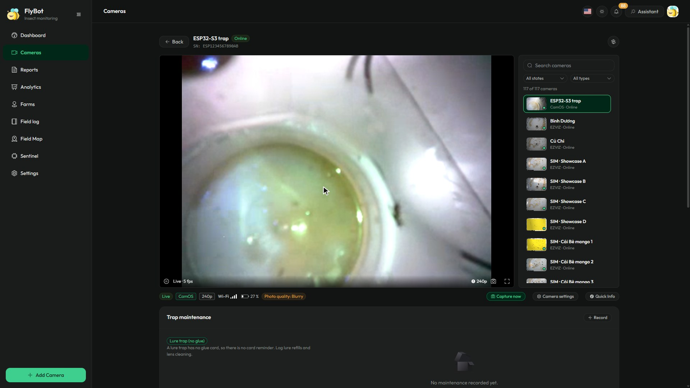
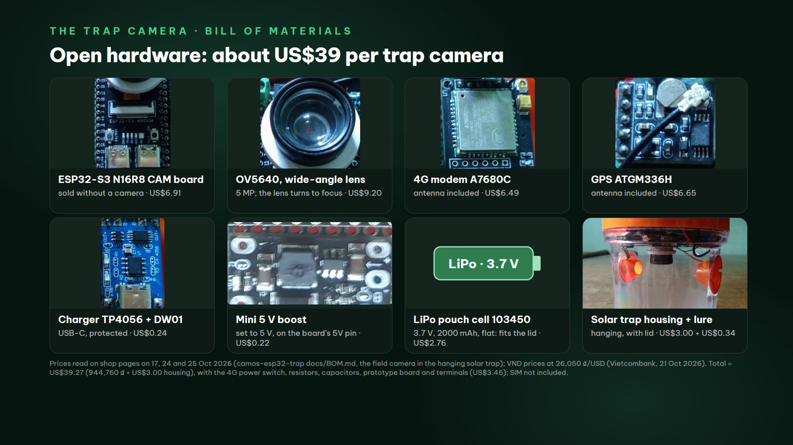

# Camera bẫy ruồi vàng CamOS (ESP32-S3)

[English](README.md) · **Tiếng Việt**

Một camera nhỏ chạy bằng năng lượng mặt trời, gắn trong nắp của một bẫy ruồi vàng treo. Camera nhìn xuống lòng bẫy, chụp
nhiều lần mỗi ngày và gửi ảnh lên [FlyBot](https://flybot.agrhub.com) để đếm ruồi vàng giúp bạn. Chất dẫn dụ trong bẫy
thu hút ruồi bay vào; không có tấm keo nào phải thay.

- Chạy bằng Wi-Fi, hoặc 4G với thẻ SIM khi đặt ngoài vườn.
- Tấm pin mặt trời trên nắp sạc cho pin LiPo dẹt: camera ngủ giữa các lần chụp và tự thức dậy đúng giờ.
- GPS: FlyBot tự đặt vị trí bẫy lên bản đồ.
- Trang web ngay trên camera để xem trực tiếp, cài đặt và xem ảnh lưu trên thẻ nhớ.
- Xem trực tiếp trong FlyBot từ bất cứ đâu (cả hai loại board ESP32-S3): hình H.264 hoặc ảnh JPEG của camera qua
  WebRTC, xem mục 7.

## 1. Cần mua gì

- Board camera: board **ESP32-S3 N16R8 CAM** loại không kèm camera và **module OV5640 có ống kính chỉnh được**
  (419.640 ₫, khoảng 16 USD), hoặc board **Freenove ESP32-S3 CAM (FNK0085)** (19,99 USD), cùng vỏ bẫy: bẫy treo năng
  lượng mặt trời trong ảnh giá 3,00 USD. Như vậy là một camera Wi-Fi, khoảng 19 USD.
- Ngoài vườn thêm: module 4G và module GPS (đều kèm anten), pin LiPo dẹt, mạch sạc, mạch tăng áp 5 V, công tắc nguồn cho
  module 4G, board test có domino và chất dẫn dụ: 944.760 ₫ linh kiện, khoảng 39 USD cả vỏ bẫy (26.050 ₫/USD, tỷ giá
  Vietcombank ngày 21/10/2026). Tấm pin mặt trời có sẵn trên nắp bẫy sạc cho pin.
- Cách khác: hộp IP65 trên cọc nhìn vào tấm bẫy dính vàng, với tấm pin 6 V 2 W và anten GPS chủ động, khoảng 60 USD
  ([ASSEMBLY.md](docs/ASSEMBLY.md), mục 4).
- Danh sách đầy đủ, link cửa hàng và giá đọc ngày 17, 24 và 25/10/2026: [docs/BOM.md](docs/BOM.md).
- Máy tính có Chrome hoặc Edge (để nạp firmware), điện thoại (để cài Wi-Fi), thẻ microSD (FAT32, không bắt buộc nhưng
  nên có) và tài khoản [FlyBot](https://flybot.agrhub.com).

**Các bước cài một camera, tóm tắt:**

| Bước | Việc | Hướng dẫn | Thời gian |
|---|---|---|---|
| 2 | Đấu dây camera ngoài vườn và lắp vào nắp bẫy (camera Wi-Fi cắm USB thì bỏ qua) | [WIRING.md](docs/WIRING.md), [ASSEMBLY.md](docs/ASSEMBLY.md) | một buổi chiều |
| 3 | Nạp firmware cho board | [FLASHING.md](docs/FLASHING.md) | 5 phút |
| 4 | Kết nối Wi-Fi (SIM 4G thì không cần làm gì) | [PORTAL.md](docs/PORTAL.md) | 2 phút |
| 5 | Nhận camera trên FlyBot | mục 5 bên dưới | 1 phút |
| 6 | Đặt mật khẩu admin và kiểm tra hình trên trang web của camera | [WEB_CONSOLE.md](docs/WEB_CONSOLE.md) | 5 phút |
| 7 | Treo bẫy ngoài vườn, rồi theo dõi ruồi trên FlyBot | mục 7 bên dưới | |

Các hướng dẫn chi tiết trong `docs/` viết bằng tiếng Anh.

## 2. Lắp bẫy

**Camera Wi-Fi** không cần đấu dây: board, camera và một cục sạc USB (cục sạc điện thoại 5 V bất kỳ, từ 1 A).

**Camera ngoài vườn** (4G + GPS + pin + năng lượng mặt trời) được đấu trên một board test nhỏ trong nắp bẫy. Đấu đúng
như sơ đồ thì firmware 0.9.2 (bản phát hành hiện tại) không cần cài gì thêm; chỉ cần đánh dấu "Đã lắp mạch đo pin / pin
mặt trời" khi đã lắp cầu chia áp (trên trang cài đặt hoặc trang web của camera). Bản 0.9.1 trở về trước dùng GPIO47 để
kích chân PWRKEY nên không giữ được công tắc nguồn 4G.

- Từng dây, từng chân, cùng công tắc nguồn 4G và cầu chia áp pin: [docs/WIRING.md](docs/WIRING.md).
- Linh kiện, link cửa hàng và giá: [docs/BOM.md](docs/BOM.md).
- Lắp vào nắp, góc nhìn của camera, anten và treo bẫy: [docs/ASSEMBLY.md](docs/ASSEMBLY.md).

Nạp firmware (bước 3) trước khi lắp vào nắp: lúc đó dễ cắm cổng USB và bấm nút hơn.

## 3. Nạp firmware cho board (3 bước, không cần cài phần mềm)

1. Mở **https://agrhub.github.io/camos-esp32-trap/flash/** bằng **Chrome hoặc Edge** trên máy tính.
2. Cắm board vào máy tính bằng cáp USB-C có truyền dữ liệu (cổng ghi **CH340** / UART).
3. Bấm **Install** cạnh tên board, chọn cổng COM, xác nhận. Mất khoảng một phút.

Dùng **Install** cho camera mới. Camera đang chạy tốt thì dùng **Update**: giữ nguyên cài đặt và đăng ký với FlyBot.
Camera đang chạy cũng tự cập nhật được từ trang web của nó (Bảo trì & nâng cấp) hoặc từ FlyBot.

Hướng dẫn đầy đủ (cổng không hiện, chế độ tải firmware, nạp không qua trang web bằng `esptool` và file phát hành, build
từ mã nguồn bằng `tools\build.ps1`): **[docs/FLASHING.md](docs/FLASHING.md)**.

## 4. Kết nối Wi-Fi (hoặc 4G)

Có SIM trong module 4G thì camera tự lên mạng (APN được chọn theo SIM): chuyển sang bước 5. Với Wi-Fi, dùng điện thoại:

| | |
|---|---|
|  | 1. Cấp điện cho camera. Đèn **xanh dương thở chậm**: camera phát Wi-Fi riêng `CAM-xxxx`. Trên điện thoại, kết nối **`CAM-xxxx`**, mật khẩu **`camos1234`**. Trang cài đặt tự mở (nếu không, mở `http://192.168.4.1`).  2. Chọn Wi-Fi nhà bạn (2,4 GHz), nhập mật khẩu, bấm **Kết nối**.  3. Camera thử kết nối và trang đếm số giây.  4. **Đã kết nối**: camera khởi động lại vào Wi-Fi nhà bạn. Đèn nháy vàng, rồi chớp xanh lá: camera đã lên mạng. Ghi lại tên trên trang, `http://flybot-xxxxxx.local/`: đó là trang web của camera (bước 6). |

Sai mật khẩu thì trang báo lỗi để bạn nhập lại. "Cài đặt nâng cao" trên cùng trang có APN 4G, chu kỳ chụp, chế độ
nguồn, múi giờ và địa chỉ FlyBot; mọi ô đã có sẵn giá trị dùng được. Từng bước, từng cài đặt nâng cao và cách xử lý khi
không được: **[docs/PORTAL.md](docs/PORTAL.md)**.

Muốn mở lại trang cài đặt sau này (đổi router, đổi mật khẩu): **giữ nút BOOT 3 giây** khi camera đang chạy và thả ra khi
đèn chuyển xanh dương. Mọi cài đặt giữ nguyên.

## 5. Nhận camera trên FlyBot

| | |
|---|---|
|  | Camera mới tự đăng ký với FlyBot và chờ chủ nhận. Khi chưa được nhận, camera ở trạng thái "Chưa có chủ" và gửi tối đa một ảnh mỗi giờ.   1. Đăng nhập **https://flybot.agrhub.com** (trên máy tính hoặc điện thoại).  2. Trên trang Camera, chọn **Thêm camera** và quét mã QR trên trang cài đặt hoặc trang web của camera, hoặc nhập **số serial** và **mã xác minh** in bên cạnh (cũng có trong Thông tin thiết bị trên trang web).  3. Đặt tên và chọn **Loại bẫy**: **Bẫy dẫn dụ (không keo)** cho bẫy treo, **Bẫy dính (tấm keo)** cho tấm bẫy dính. Vị trí GPS (hoặc kéo thả trên **Bản đồ**) đặt camera lên bản đồ.  4. Từ đó camera chụp theo lịch đặt trên FlyBot. |

## 6. Trang web của camera

Khi camera đã vào Wi-Fi nhà bạn, mở **`http://flybot-xxxxxx.local/`** trên trình duyệt của máy cùng mạng Wi-Fi, trong đó
`xxxxxx` là 6 ký tự cuối của số serial, viết thường (serial `ESP000000000001` thành `flybot-000001.local`). Nhiều trình
duyệt Android không mở được tên `.local`, khi đó dùng `http://<IP camera>/` (IP có trong danh sách thiết bị của router,
nơi camera hiện tên `flybot-xxxxxx`). Lần đầu trang yêu cầu đặt **mật khẩu admin** (8-64 ký tự, có chữ và số).

| Xem trực tiếp | Phát hiện chuyển động |
|---|---|
|  |  |

Trên trang web bạn xem hình trực tiếp và chỉnh nét, xem ảnh trên thẻ nhớ, xem thông tin thiết bị, cập nhật firmware,
đổi Wi-Fi hoặc cài đặt 4G, chỉnh hình ảnh, đặt lịch chụp, xem pin và năng lượng mặt trời, lấy vị trí GPS và đổi mật
khẩu. Ảnh chụp màn hình từng trang (tiếng Anh) ở [README.md](README.md#6-the-cameras-web-page). *Hình trong các ảnh chụp
màn hình là hình vẽ tấm bẫy dính từ camera giả lập, không phải ảnh từ camera.* Mô tả từng trang:
[docs/WEB_CONSOLE.md](docs/WEB_CONSOLE.md).

**Trước khi treo bẫy**, đậy nắp, mở Xem trực tiếp và kiểm tra ba điều: đáy bẫy chiếm gần hết khung hình, hình rõ nét
(xoay nhẹ ống kính của module OV5640 để chỉnh nét) và hình không bị lật (Hình ảnh > Hiển thị > Hướng ảnh).

## 7. Sử dụng hằng ngày

**Camera tự làm gì.** Camera chụp ảnh bẫy theo lịch đặt trên FlyBot (camera tự chạy lịch riêng thì chụp mỗi giờ một
ảnh, cả ngày, cho đến khi bạn đặt khung giờ), lưu một bản trên thẻ nhớ và gửi lên. FlyBot đếm ruồi vàng trên từng ảnh.
Chạy pin thì camera ngủ giữa các lần chụp và tự thức dậy đúng giờ; cắm điện, hoặc pin đầy và đang sạc, thì camera luôn
trực tuyến. Mỗi ngày camera lấy vị trí GPS một lần, nên FlyBot tự đặt bẫy lên bản đồ.

**Bạn làm gì trên FlyBot** (https://flybot.agrhub.com, trên máy tính hoặc điện thoại), từ bất cứ đâu:

- theo dõi số ruồi của từng bẫy; đặt ngưỡng cảnh báo cho từng camera và nhận email hoặc tin Telegram khi bẫy chạm
  ngưỡng, hoặc khi camera mất kết nối;
- xem ảnh kèm số ruồi đếm được, và chụp ảnh mới bằng **Chụp ngay**;
- xem hình trực tiếp (xem bên dưới);
- đổi lịch chụp và chế độ nguồn của camera (pin và năng lượng mặt trời, hoặc điện lưới), và từ bản 0.9.2 cả mạng
  (Wi-Fi, 4G hoặc tự động) và hệ vệ tinh GPS; camera đang ngủ nhận thay đổi ở lần thức dậy kế tiếp;
- cập nhật firmware cho camera;
- xem mọi bẫy trên **Bản đồ**.

**Bạn làm gì trên trang web của camera** (chỉ khi cùng mạng Wi-Fi): cài đặt, kiểm tra hình và độ nét, đổi Wi-Fi hoặc cài
đặt 4G, xem ảnh trên thẻ nhớ, đọc log khi có trục trặc.

**Đổ bẫy và thay chất dẫn dụ.** Đổ bẫy và thêm chất dẫn dụ theo nhãn của chất dẫn dụ hoặc theo kế hoạch phòng trừ của
bạn, và lau ống kính cùng mặt trong thân bẫy khi bị bẩn. Đậy nắp lại đúng chiều cũ để khung hình không đổi. Ghi lại việc
này ở mục **Bảo trì bẫy** trên trang camera của FlyBot, rồi chụp một ảnh (Xem trực tiếp > Gửi lên FlyBot, hoặc **Chụp
ngay** trên FlyBot) để bắt đầu lượt đếm mới. Với tấm bẫy dính (cách khác, [ASSEMBLY.md](docs/ASSEMBLY.md) mục 4), thay
tấm keo khi đã đầy và đặt tấm mới đúng chỗ cũ.

**Xem trực tiếp trong FlyBot (khi không ở nhà).** Camera (cả hai loại board ESP32-S3) còn gửi hình trực tiếp lên trang
camera của FlyBot qua Internet (Amazon Kinesis Video Streams WebRTC), mỗi lần một người xem. Menu chất lượng dưới khung
hình chọn 240p (320x240 H.264, khoảng 5-8 hình mỗi giây) hoặc một cỡ hình camera phát được (480p, HD, FullHD, 2K): các
cỡ này gửi ảnh JPEG của chính camera, tới 15 hình mỗi giây ở 640x480 khi Wi-Fi tải lên tốt. Tự động chọn 640x480, và
camera tự hạ xuống khi đường truyền không tải nổi. Cắm điện (hoặc chế độ nguồn powered) thì camera luôn sẵn sàng. Chạy
pin thì camera vào khi FlyBot yêu cầu, ở lần thức dậy kế tiếp: từ bản 0.9.2, ban ngày trên Wi-Fi camera thức dậy kiểm
tra nhanh mỗi 2-10 phút; ngoài ra (và luôn luôn khi chạy 4G) là ở lần chụp kế tiếp. Khi có người đang xem từ FlyBot,
trang web của camera báo "bận" thay cho hình trực tiếp, và lần chụp theo lịch làm hình trực tiếp dừng vài giây. FlyBot
tự cấp khóa xem trực tiếp cho camera (flybot.agrhub.com đã bật); với firmware cũ, FlyBot đưa ra ảnh chụp và trang web
của camera thay thế. Chi tiết: [docs/dev/LIVE_VIEW.md](docs/dev/LIVE_VIEW.md).

**Ảnh trên thẻ nhớ.** Xem ở mục Xem lại trên trang web, hoặc tháo thẻ ra (tắt nguồn trước), hoặc cắm cổng USB gốc của
board vào máy tính: thẻ nhớ hiện ra như một ổ USB và camera như một webcam
([WEB_CONSOLE.md](docs/WEB_CONSOLE.md#native-usb-port-card-reader-webcam-or-usb-drive)).

**Cập nhật firmware.** FlyBot đề xuất firmware mới cho camera; hoặc dùng Bảo trì & nâng cấp trên trang web. Camera giữ
nguyên cài đặt và đăng ký, và tự quay về firmware cũ nếu bản mới không kết nối được.

## 8. Ý nghĩa đèn LED

| Đèn (trên board) | Ý nghĩa |
|---|---|
| xanh dương, thở chậm | chế độ cài đặt: dùng điện thoại kết nối `CAM-xxxx` |
| vàng, nháy nhanh | đang kết nối Wi-Fi / 4G / FlyBot |
| chớp xanh lá mỗi 5 giây (phút đầu) | đã lên mạng |
| một lần chớp trắng | đang chụp ảnh |
| đỏ, nháy đôi | có lỗi: không có mạng, hoặc FlyBot từ chối camera (xem trang cài đặt) |
| cam, nháy 3 lần | pin yếu, camera đi ngủ |
| tím | đang cài firmware mới: không rút điện |
| tắt | đang ngủ giữa các lần chụp, hoặc đã lên mạng quá một phút |

Chi tiết: [docs/LED.md](docs/LED.md).

## 9. Xử lý sự cố

- **Không vào được Wi-Fi.** Sau khoảng một phút camera mở lại `CAM-xxxx` và trang cài đặt ghi rõ lý do. Kiểm tra mật
  khẩu; camera cần mạng 2,4 GHz (không dùng được mạng chỉ có 5 GHz).
- **Không có 4G.** Kiểm tra SIM còn dung lượng data và không có mã PIN (hoặc nhập PIN trong Cài đặt nâng cao), anten đã
  gắn chắc, module 4G có dây nguồn riêng to và ngắn từ pin cùng tụ 1000 uF ở chân VCC (nó cần dòng đỉnh tới 2 A). Mục 4G
  trên trang web hiện nhà
  mạng và mức sóng.
- **Hình bị đen.** Ban đêm là bình thường: camera không có đèn hồng ngoại. Đặt khung giờ chụp ban ngày (Lịch chụp). Ban
  ngày mà vẫn đen: kiểm tra ống kính có bị che không và cáp camera đã cắm hết vào chưa.
- **Hình bị mờ.** Lau ống kính và thân bẫy, rồi chỉnh nét ống kính OV5640 vào đáy bẫy (xoay nhẹ, nhìn Xem trực tiếp).
- **Không có vị trí GPS.** GPS cần nhìn thấy bầu trời; trong nhà thường không bắt được. Lần đầu có thể mất vài phút. Nút
  GPS > Lấy vị trí ngay sẽ thử lại liền.
- **Nút BOOT.** Khi camera đang chạy, **giữ 3 giây rồi thả khi đèn chuyển xanh dương**: camera vào chế độ cài đặt
  (`CAM-xxxx`), mọi cài đặt và mật khẩu trang web giữ nguyên. **Giữ 10 giây đến khi đèn chuyển đỏ** để khôi phục cài
  đặt gốc: cài đặt và mật khẩu trang web về mặc định, rồi camera vào chế độ cài đặt. Đăng ký FlyBot luôn giữ nguyên.
- **Quên mật khẩu trang web.** Giữ nút BOOT 10 giây như trên, kết nối lại Wi-Fi nhà bạn, lần sau mở trang web sẽ đặt
  mật khẩu mới.
- **Muốn làm lại từ đầu.** Trang web > Bảo trì & nâng cấp > Khôi phục cài đặt gốc (giữ đăng ký), hoặc nạp lại bản
  **Install** (xóa hết; khi đó cần reset camera trên FlyBot thì camera mới đăng ký lại được).
- **FlyBot báo camera "Chưa có chủ".** Nhận camera (mục 5). Trước đó camera gửi tối đa một ảnh mỗi giờ.
- **Vẫn chưa được?** Trang web > Hệ thống > Nhật ký > Tải về, gửi file kèm câu hỏi của bạn.

## 10. Dành cho lập trình viên

Xem phần "For developers" trong [README.md](README.md#10-for-developers) (tài liệu kỹ thuật bằng tiếng Anh).

## Giấy phép

GNU Affero General Public License v3.0 only (AGPL-3.0-only), Copyright (C) 2026 AGRHUB: xem [LICENSE](LICENSE). Các thành phần của bên thứ ba trong firmware giữ giấy phép riêng: xem [NOTICE](NOTICE). Nếu bạn chạy bản đã sửa đổi để người khác dùng qua mạng, AGPL yêu cầu bạn cung cấp mã nguồn của bản đó. Việc liên kết các thư viện chỉ có dạng nhị phân của Espressif (Wi-Fi, PHY, esp_peer, esp_h264) được cho phép bởi một quyền bổ sung theo điều 7 của AGPL, ghi trong [NOTICE](NOTICE).
