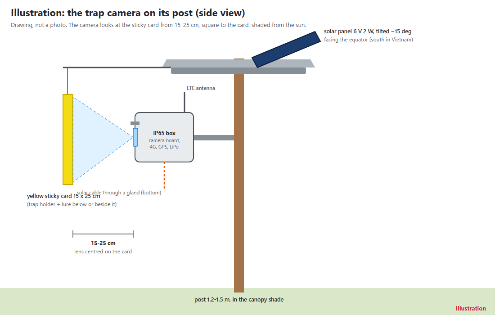
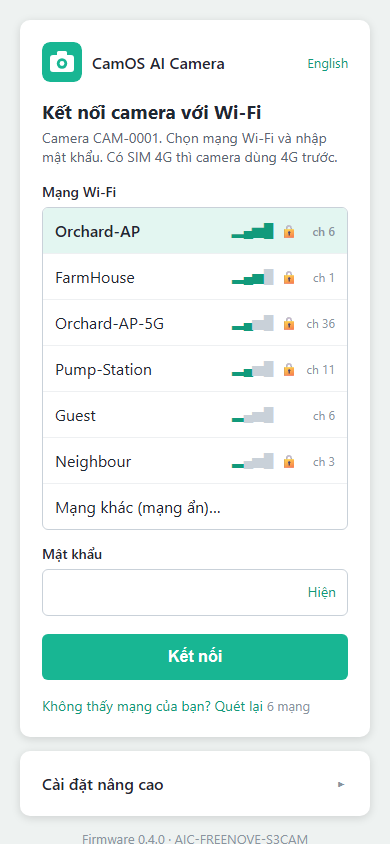
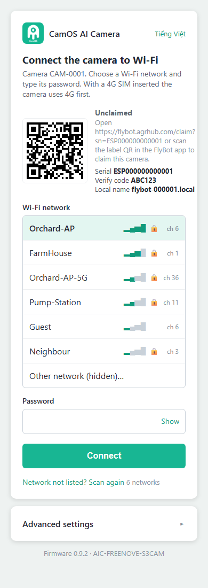
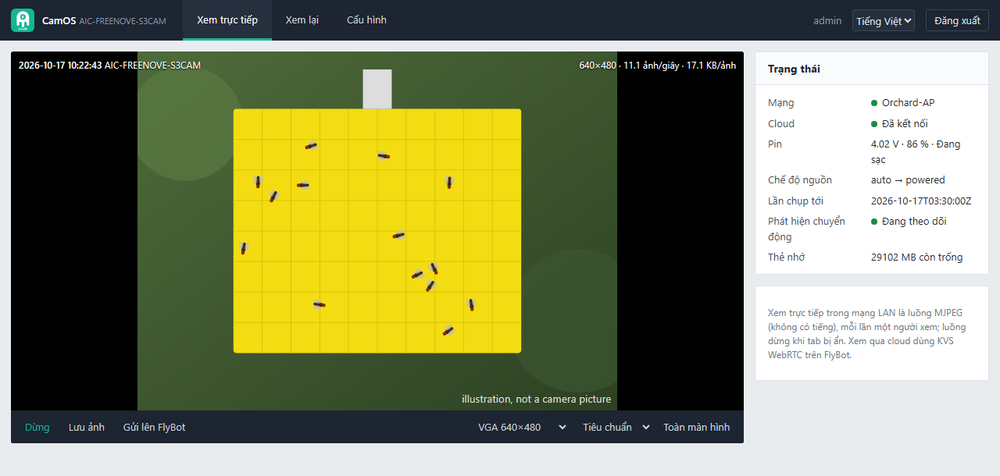
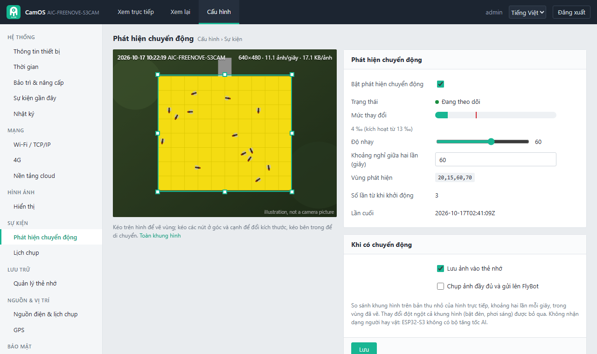

# Camera bẫy ruồi vàng CamOS (ESP32-S3)

[English](README.md) · **Tiếng Việt**



Một camera nhỏ chạy bằng năng lượng mặt trời, chụp tấm bẫy dính vàng trong vườn nhiều lần mỗi ngày và gửi ảnh lên
[FlyBot](https://flybot.agrhub.com) để đếm ruồi vàng giúp bạn. *(Hình minh họa; ảnh chụp bẫy hoàn chỉnh sẽ được bổ sung
tại `docs/img/trap-assembled.jpg`.)*

- Chạy bằng Wi-Fi, hoặc 4G với thẻ SIM khi đặt ngoài vườn.
- Tấm pin mặt trời + pin sạc: camera ngủ giữa các lần chụp và tự thức dậy đúng giờ.
- GPS: FlyBot tự đặt vị trí bẫy lên bản đồ.
- Trang web ngay trên camera để xem trực tiếp, cài đặt và xem ảnh lưu trên thẻ nhớ.
- Xem trực tiếp trong FlyBot từ bất cứ đâu (board Freenove): hình H.264 nhỏ qua WebRTC, xem mục 5.

## 1. Cần mua gì

- Board camera **Freenove ESP32-S3 CAM (FNK0085)**, thẻ microSD và hộp chống nước: khoảng 430.000 ₫ + board (19,99 USD)
  cho camera Wi-Fi.
- Ngoài vườn thêm: module 4G, module GPS, pin LiPo, tấm pin mặt trời và mạch sạc: khoảng 1.130.000 ₫ + board.
- Danh sách đầy đủ, link cửa hàng và giá đọc ngày 17/10/2026: [docs/BOM.md](docs/BOM.md).
- Sơ đồ đấu dây camera ngoài vườn: [docs/WIRING.md](docs/WIRING.md). Lắp vào hộp và lên cọc:
  [docs/ASSEMBLY.md](docs/ASSEMBLY.md).

## 2. Nạp firmware cho board (3 bước, không cần cài phần mềm)

1. Mở **https://agrhub.github.io/camos-esp32-trap/flash/** bằng **Chrome hoặc Edge** trên máy tính.
2. Cắm board vào máy tính bằng cáp USB-C (cổng ghi **CH340** / UART).
3. Bấm **Install** cạnh tên board, chọn cổng COM, xác nhận. Mất khoảng một phút.

Dùng **Install** cho camera mới. Camera đang chạy tốt thì dùng **Update**: giữ nguyên cài đặt và đăng ký với FlyBot.
Camera đang chạy cũng tự cập nhật được từ trang web của nó (Bảo trì & nâng cấp).

**Không dùng trình nạp trên web:** tải `camos-esp32-trap-freenove-v<phiên bản>-install.bin` từ
[Releases](https://github.com/agrhub/camos-esp32-trap/releases) và ghi vào địa chỉ 0:

```
python -m esptool --chip esp32s3 --port COM7 write_flash 0x0 camos-esp32-trap-freenove-v0.4.2-install.bin
```

(cài `esptool` bằng `pip install esptool`; trên Linux cổng là `/dev/ttyUSB0`.)

## 3. Kết nối Wi-Fi (hoặc 4G)

Có SIM trong module 4G thì camera tự lên mạng (APN được chọn theo SIM). Với Wi-Fi:

| | |
|---|---|
|  | 1. Cấp điện cho camera. Đèn **xanh dương thở chậm**: camera phát Wi-Fi riêng `CAM-xxxx`. <br>2. Trên điện thoại, kết nối **`CAM-xxxx`**, mật khẩu **`camos1234`**. Trang cài đặt tự mở (nếu không, mở `http://192.168.4.1`). <br>3. Chọn Wi-Fi nhà bạn, nhập mật khẩu, bấm **Kết nối**. <br>4. Đèn nháy vàng, rồi chớp xanh lá: camera đã lên mạng. Nếu sai mật khẩu, mạng `CAM-xxxx` hiện lại sau khoảng một phút kèm thông báo. |

"Cài đặt nâng cao" trên cùng trang có APN 4G, chu kỳ chụp, chế độ nguồn, múi giờ và địa chỉ FlyBot. Mọi ô đã có sẵn giá
trị dùng được: không cần đổi gì nếu không cần thiết. [Thêm về trang cài đặt](docs/PORTAL.md).

## 4. Nhận camera trên FlyBot

| | |
|---|---|
|  | Camera mới tự đăng ký với FlyBot và chờ chủ nhận. Khi chưa được nhận, camera ở trạng thái "Chưa có chủ" và gửi tối đa một ảnh mỗi giờ. <br><br>1. Đăng nhập **https://flybot.agrhub.com**. <br>2. Chọn **Thêm camera** và quét mã QR trên trang cài đặt hoặc trang web của camera, hoặc nhập **số serial** và **mã xác minh** in bên cạnh. <br>3. Từ đó camera chụp theo lịch đặt trên FlyBot. |

## 5. Trang web của camera

Khi camera đã vào Wi-Fi nhà bạn, mở **`http://flybot-xxxxxx.local/`** trên trình duyệt của máy cùng mạng Wi-Fi, trong đó
`xxxxxx` là 6 ký tự cuối của số serial, viết thường (serial `ESP32S3-0A1B2C` thành `flybot-0a1b2c.local`). Trang cài
đặt và lệnh serial `info` hiện đúng tên này. Windows, macOS, iPhone và Linux mở được; nhiều trình duyệt Android không
mở được tên `.local`, khi đó dùng `http://<IP camera>/` (IP có trong danh sách thiết bị của router, nơi camera hiện tên
`flybot-xxxxxx`, hoặc trên trang Wi-Fi của camera). Lần đầu trang yêu cầu đặt **mật khẩu admin** (8-64 ký tự, có chữ và số).

| Xem trực tiếp | Phát hiện chuyển động |
|---|---|
|  |  |

Ảnh chụp màn hình các trang khác (tiếng Anh) ở [README.md](README.md#5-the-cameras-web-page). *Hình trong các ảnh chụp màn
hình là hình vẽ tấm bẫy, không phải ảnh từ camera.* Mô tả từng trang: [docs/WEB_CONSOLE.md](docs/WEB_CONSOLE.md).

**Xem trực tiếp trong FlyBot (khi không ở nhà).** Camera Freenove còn gửi hình trực tiếp lên trang camera của FlyBot qua
Internet (Amazon Kinesis Video Streams WebRTC): 320x240 H.264, khoảng 5-8 hình mỗi giây trên board đã đo, mỗi lần một
người xem. Cắm điện thì camera luôn sẵn sàng; chạy pin thì camera vào khi FlyBot yêu cầu (ở lần thức dậy kế tiếp). Khi
có người đang xem từ FlyBot, trang web của camera báo "bận" thay cho hình trực tiếp, và lần chụp theo lịch rơi vào lúc
đó được bỏ qua. FlyBot tự cấp khóa xem trực tiếp cho camera (flybot.agrhub.com đã bật); với firmware cũ, FlyBot đưa ra
ảnh chụp và trang web của camera thay thế. Chi tiết: [docs/dev/LIVE_VIEW.md](docs/dev/LIVE_VIEW.md).

## 6. Ý nghĩa đèn LED

| Đèn (trên board) | Ý nghĩa |
|---|---|
| xanh dương, thở chậm | chế độ cài đặt: dùng điện thoại kết nối `CAM-xxxx` |
| vàng, nháy nhanh | đang kết nối Wi-Fi / 4G / FlyBot |
| chớp xanh lá mỗi 5 giây (phút đầu) | đã lên mạng |
| một lần chớp trắng | đang chụp ảnh |
| đỏ, nháy đôi | có lỗi: không có mạng, hoặc FlyBot từ chối camera (xem trang cài đặt) |
| cam, nháy 3 lần | pin yếu, camera đi ngủ |
| tím | đang cài firmware mới: không rút điện |
| tắt | đang ngủ giữa các lần chụp, hoặc đã lên mạng quá một phút |

## 7. Xử lý sự cố

- **Không vào được Wi-Fi.** Sau khoảng một phút camera mở lại `CAM-xxxx` và trang cài đặt ghi rõ lý do. Kiểm tra mật
  khẩu; camera cần mạng 2,4 GHz (không dùng được mạng chỉ có 5 GHz).
- **Không có 4G.** Kiểm tra SIM còn dung lượng data và không có mã PIN (hoặc nhập PIN trong Cài đặt nâng cao), anten đã
  vặn chặt, module 4G có dây nguồn riêng to và ngắn từ pin (nó cần dòng đỉnh tới 2 A). Mục 4G trên trang web hiện nhà mạng
  và mức sóng.
- **Hình bị đen.** Ban đêm là bình thường: camera không có đèn hồng ngoại. Đặt khung giờ chụp ban ngày (Lịch chụp). Ban
  ngày mà vẫn đen: kiểm tra ống kính có bị che không và cáp camera đã cắm hết vào chưa.
- **Nút BOOT.** Khi camera đang chạy, **giữ 3 giây rồi thả khi đèn chuyển xanh dương**: camera vào chế độ cài đặt
  (`CAM-xxxx`), mọi cài đặt và mật khẩu trang web giữ nguyên. **Giữ 10 giây đến khi đèn chuyển đỏ** để khôi phục cài
  đặt gốc: cài đặt và mật khẩu trang web về mặc định, rồi camera vào chế độ cài đặt. Đăng ký FlyBot luôn giữ nguyên.
- **Quên mật khẩu trang web.** Giữ nút BOOT 10 giây như trên, kết nối lại Wi-Fi nhà bạn, lần sau mở trang web sẽ đặt
  mật khẩu mới.
- **Muốn làm lại từ đầu.** Trang web > Bảo trì & nâng cấp > Khôi phục cài đặt gốc (giữ đăng ký), hoặc nạp lại bản
  **Install** (xóa hết; khi đó cần reset camera trên FlyBot thì camera mới đăng ký lại được).
- **FlyBot báo camera "Chưa có chủ".** Nhận camera (mục 4). Trước đó camera gửi tối đa một ảnh mỗi giờ.

## 8. Dành cho lập trình viên

Xem phần "For developers" trong [README.md](README.md#8-for-developers) (tài liệu kỹ thuật bằng tiếng Anh).

## Giấy phép

GNU Affero General Public License v3.0 only (AGPL-3.0-only), Copyright (C) 2026 AGRHUB: xem [LICENSE](LICENSE). Các thành phần của bên thứ ba trong firmware giữ giấy phép riêng: xem [NOTICE](NOTICE). Nếu bạn chạy bản đã sửa đổi để người khác dùng qua mạng, AGPL yêu cầu bạn cung cấp mã nguồn của bản đó. Việc liên kết các thư viện chỉ có dạng nhị phân của Espressif (Wi-Fi, PHY, esp_peer, esp_h264) được cho phép bởi một quyền bổ sung theo điều 7 của AGPL, ghi trong [NOTICE](NOTICE).
