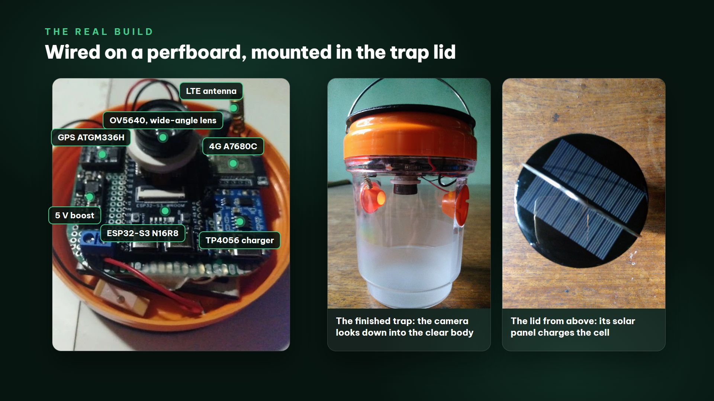

# Assembling the trap camera

The reference build is a **hanging solar trap** (BOM item 3): the board, the modules and their wiring sit on a
prototype board inside its lid, the camera looks down into the clear body of the trap, and the solar panel on top of
the lid charges a flat LiPo cell. The lure inside draws the flies in, so there is no glue card to change. Another way,
an IP65 box on a post that looks at a yellow sticky card, is in section 4.

Parts: [BOM.md](BOM.md). Wiring: [WIRING.md](WIRING.md). Flash and set up the camera on the bench first (README), and
take one snapshot from the web console before anything goes into the lid.

## 1. Inside the lid

1. **Camera.** Mount the ESP32-S3 board on the prototype board with the OV5640 in the centre of the lid, the lens
   pointing **straight down** into the clear body. Leave the camera ribbon free of sharp bends, and fix the camera
   module with a dab of hot glue or double-sided foam so that it cannot tilt.
2. **Modules.** Around the board: the TP4056 charger, the 5 V boost board and the screw terminals on the prototype
   board, the 4G board with its LTE antenna on one side, the GPS board on the other with its patch antenna **facing
   up** under the lid, as far from the LTE antenna as the lid allows.
3. **Battery.** The flat LiPo cell (103450) lies under the prototype board, held with foam tape, on its own screw
   terminal.
4. **Solar.** The lid's own panel goes to the charger's input through the second screw terminal ([WIRING.md](WIRING.md));
   tick "Battery / solar divider fitted" once the dividers are in.
5. **Moisture.** Put a small bag of silica gel in the lid before you close it, and keep cables away from the rim so
   the lid closes flat.

## 2. The camera's view

- **Focus.** Close the lid, open Live View in the web console and turn the lens of the OV5640 module (BOM item 1a)
  until the bottom of the trap is sharp, then lock it (its lock ring or a drop of glue). A fixed lens focused far away
  (the Freenove kit's) is sharp only from about 50 cm.
- **Framing.** The bottom of the trap should fill most of the picture. Check it at 1280 x 720 or 1600 x 1200 in Live
  View, then Configuration > Image to adjust brightness or sharpness. Save, take a snapshot ("Send to FlyBot") and
  look at it in FlyBot.
- **Light.** Daylight comes in through the clear body. There is no infrared light: photos at night are black, so set a
  capture window for the daylight hours (Configuration > Event > Capture Schedule).
- **Clean.** Keep the lens and the clear body clean: every smudge and drop shows on the photos.

## 3. In the orchard

1. Put the lure in the trap as its label says (BOM item 6c).
2. Hang the trap by its handle 1.2-1.5 m high, where the farm normally hangs its fruit-fly traps, with sun on the lid
   for as many hours as possible so the panel can charge the cell. Tie it firmly: a trap that swings blurs the photos.
3. **4G:** the LTE antenna stays inside the lid; the web console's 4G page shows the signal. Where it is weak, an
   external antenna (BOM item 9b) on a pigtail does better.
4. Power on and wait for the LED: green blip = online. Check the camera in FlyBot (it uploads its first photo at the
   next capture slot) and on the 4G / Wi-Fi page of the web console.
5. In FlyBot, set the camera's **Trap type** to **Lure trap (no glue)** (when you claim it, or later on the Cameras
   page): FlyBot then counts the flies present on each photo instead of the rise on a glue card, and its Trap
   maintenance card tracks lure refills and lens cleaning.

## 4. The other way: an IP65 box and a sticky card

*Illustration, not a photo.* The same electronics fit an IP65 box (BOM items 3a, 3b) that looks at a yellow sticky card
(item 5), with a 6 V 2 W panel (item 13) and an active GPS antenna (item 11).

- **Window.** Cut a 20 mm round hole in the side of the box that faces the card (or use a box with a clear lid) and
  glue clear acrylic over it from the inside with neutral silicone. Mount the lens **centred behind the window, 2-5 mm
  from it**, square to it.
- **Card.** 15-25 cm from the lens, square to it and centred, filling most of the live picture. Shade the card and the
  window from direct sun (a small roof over both), and mount the card and the box on the **same post or bracket** so
  wind moves both together.
- **Post.** 1.2-1.5 m, in the shade of the canopy. The panel goes on the roof, facing the equator (south in Vietnam),
  tilted about 15 degrees; its cable enters the box at the bottom through a cable gland, with a drip loop below.
- **Card changes.** Replace the card when it is full and put the new one in the same place so the picture stays framed.

## 5. Photos still to take for this guide

| File | What to show |
|---|---|
| `docs/img/trap-orchard.jpg` | the trap hanging in its place among the trees |
| `docs/img/trap-view.jpg` | the trap as the camera sees it: a full-size snapshot downloaded from Playback |

JPEG, about 1600 px wide, under 300 KB each. No people's faces, house numbers or car plates in the frame.
