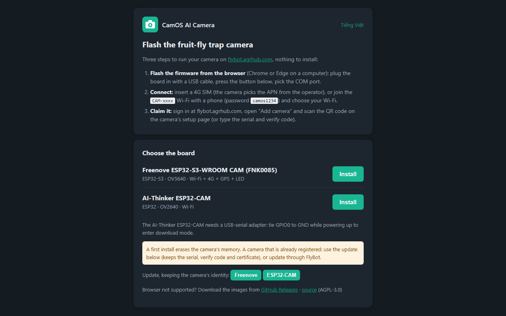

# Flashing a new board

A new board comes with no CamOS firmware on it. This page puts it there, step by step. Pick **one** of the three ways:

| Way | For whom | What you need |
|---|---|---|
| [A. Web flasher](#a-web-flasher-recommended) | everyone | Chrome or Edge on a computer |
| [B. Release file + esptool](#b-release-file--esptool) | no Chrome / Edge, or no Internet at the bench | Python 3 |
| [C. Build from source](#c-build-from-source) | changing pins, options or code | ESP-IDF v5.4 |

Then do [the first start](#after-flashing-the-first-start) and the [Wi-Fi setup](PORTAL.md).

## Before you start

- **The board.** Freenove ESP32-S3 CAM (FNK0085), or a generic ESP32-S3 N16R8 CAM with an OV5640: both run the
  `freenove` image. The AI-Thinker ESP32-CAM has its own image (Wi-Fi only, see the end of this page).
- **A USB-C data cable.** Many phone-charger cables carry power only: if the computer sees nothing, try another cable.
- **The right USB port.** The Freenove board has two USB-C ports. Flash through the one marked **CH340** (UART, the
  serial port). The other one, the native USB port, is for the card reader / webcam / USB drive later
  ([WEB_CONSOLE.md](WEB_CONSOLE.md#native-usb-port-card-reader-webcam-or-usb-drive)).
- **The CH340 driver.** Windows 10 and 11, macOS and Linux usually have it. The board shows up as
  `USB-SERIAL CH340 (COMx)` in Windows' Device Manager under "Ports (COM & LPT)". If it does not, install the CH340
  driver from the chip maker (WCH) and plug the board in again.
- **Unwired is easiest.** Flash the board before it goes into the trap box. Once it is wired as in
  [WIRING.md](WIRING.md), flashing still works, but unplug the 5 V boost board's output from the board's 5V pin first
  so the board runs from the USB cable only.
- **Firmware version.** The web flasher and the Releases page have 0.9.2, the current release. A field camera wired
  as in [WIRING.md](WIRING.md) (4G power switch on GPIO47) needs 0.9.2 or later.

## A. Web flasher (recommended)



1. Open **https://agrhub.github.io/camos-esp32-trap/flash/** in **Chrome or Edge** on a computer (not a phone; Firefox
   and Safari cannot talk to a serial port). "Tiếng Việt" at the top right switches the page to Vietnamese.
2. Plug the board into the computer through the **CH340** port.
3. Under **Choose the board**, click **Install** next to *Freenove ESP32-S3-WROOM CAM* (also for the ESP32-S3 N16R8
   CAM with an OV5640).
4. The browser lists the serial ports: pick `USB-SERIAL CH340 (COMx)` and click **Connect**.
5. Confirm **Install**. The page erases the board and writes the firmware; it takes about a minute. Do not unplug the
   board until the page says it is done.
6. Close the dialog and go on with [the first start](#after-flashing-the-first-start).

**Install or Update?** *Install* is for a new board: it erases everything, including the camera's settings and its
registration with FlyBot. For a camera that already works, use the **Update** buttons lower on the page (they keep the
serial, the verify code, the certificate and the settings), or let the camera update itself (web console >
Maintenance & Upgrade, or FlyBot).

**The port does not show up, or the flasher cannot connect:**

- Try another cable or another USB socket on the computer, and check Device Manager (see above).
- Put the board in download mode by hand: hold **BOOT**, press and release **RST**, release **BOOT**, then click
  Install again. After flashing, press **RST** once to start the new firmware.
- Close any other program that holds the port (a serial monitor, Arduino IDE, another flasher tab).

## B. Release file + esptool

1. Download `camos-esp32-trap-freenove-v<version>-install.bin` from
   [Releases](https://github.com/agrhub/camos-esp32-trap/releases) (and `SHA256SUMS` to check it, if you like).
2. Install esptool once: `pip install esptool`.
3. Find the port: `COM7` on Windows (Device Manager), `/dev/ttyUSB0` on Linux, `/dev/cu.wchusbserial*` on macOS.
4. Write the whole image at address 0:

   ```bash
   python -m esptool --chip esp32s3 --port COM7 write_flash 0x0 camos-esp32-trap-freenove-v0.9.2-install.bin
   ```

5. Press **RST** (or unplug and plug the board) and go on with [the first start](#after-flashing-the-first-start).

The `-install.bin` image erases the settings and the identity, like *Install* above. To update a camera that already
works from a file, use `-update.bin` in the web console (Maintenance & Upgrade > Upload a firmware file), or write it
at 0x20000 together with `-otadata.bin` at 0x11000.

## C. Build from source

Build from source to change pins or options, or to build your bench Wi-Fi into the image. All the details are in
[dev/BUILD.md](dev/BUILD.md); the short way on Windows:

1. **Install ESP-IDF v5.4** (releases are built with v5.4.4) with Espressif's Windows installer, or clone it to
   `C:\dev\esp-idf` and run `install.ps1 esp32s3` with `IDF_TOOLS_PATH` = `C:\dev\espressif`. In another place, set
   `$env:IDF_PATH` and `$env:IDF_TOOLS_PATH` before using the helper.
2. **Clone this repository** and open PowerShell in it.
3. **Optional: your own defaults.** Copy `firmware\defaults.example.json` to `firmware\defaults.local.json` (git-ignored)
   and fill in your bench Wi-Fi, so a freshly flashed board joins it without the setup page.
4. **Build:** `tools\build.ps1 freenove build`. The first build downloads the components (about 100 MB, Internet
   needed once) and takes several minutes; later builds take seconds.
5. **Flash:** `tools\build.ps1 freenove flash COM7` (your CH340 port).
6. **Watch it start:** `tools\build.ps1 freenove monitor COM7`; Ctrl+] leaves the monitor.
7. **Clean up** when done: `tools\build.ps1 freenove clean` deletes `firmware\build-freenove` (about 170 MB).

On Linux / macOS, `. ~/esp/esp-idf/export.sh` and the two `idf.py` commands of [dev/BUILD.md](dev/BUILD.md) do the same.

`flash` from a build never touches the settings or the identity: re-flashing a working camera keeps its Wi-Fi and its
FlyBot registration. `idf.py erase-flash` wipes them, like the *Install* image.

## After flashing: the first start

1. Press **RST** or plug the board in again. The status LED lights up within a few seconds.
2. **Blue, slowly breathing**: the camera has no network yet and opens its setup Wi-Fi `CAM-xxxx`. Go on with
   [the Wi-Fi setup](PORTAL.md). With a 4G SIM in a wired module the camera goes online by itself instead (yellow
   blinking, then a green blip): skip the Wi-Fi setup.
3. Optional: watch the first start on the serial console (`tools\build.ps1 freenove monitor COM7`, or
   `python tools/serial_log.py COM7 --reset --seconds 60` without ESP-IDF). A healthy start shows the firmware version,
   `flash 16 MB, PSRAM 8192 KB` (8 MB of flash on some Freenove boards), and then
   `setup portal: Wi-Fi CAM-xxxx, open http://192.168.4.1/  (serial ..., verify code ...)`. The **serial** and the
   **verify code** are what you need to claim the camera in FlyBot; the setup page shows them too.
4. Claim the camera in FlyBot ([README, section 5](../README.md#5-claim-it-on-flybot)).

`PSRAM ... NOT initialized` in the log means the board is not an N16R8 / N8R8 (octal PSRAM) board: the `freenove`
image needs one.

## For farm teams: preparing many cameras

Every camera registers itself with FlyBot on its first connection; nothing more is needed. A team that prepares many
cameras on the bench can do more before they leave:

- `tools\factory.ps1 COM7` (or `bash tools/factory.sh COM7`) writes the read-only factory identity: serial, verify
  code, certificate and key. It prints the AWS IoT command that registers the certificate: run it with your own AWS
  credentials. Details: [dev/FACTORY.md](dev/FACTORY.md).
- `tools/provision.sh` writes an NVS image with the Wi-Fi, the APN, the FlyBot address and a provisioning token, so
  the cameras need no setup page: [tools/README.md](../tools/README.md).
- `python tools/label.py <serial> <verify code>` draws the label QR that FlyBot's "Add camera" scans.

Everything these tools write stays in `tools/out/` (git-ignored: it holds private keys and Wi-Fi passwords).

## AI-Thinker ESP32-CAM

The AI-Thinker board has no USB port: use a USB-serial adapter. 5 V and GND from the adapter, adapter TX to U0R,
adapter RX to U0T, and GPIO0 to GND while it powers up (download mode). Then click **Install** next to *AI-Thinker
ESP32-CAM* on the web flasher, remove the GPIO0 jumper and press reset. That image has Wi-Fi, photos and deep sleep, but
no 4G, GPS, SD card or live view. Its setup button is a push button between GPIO13 and GND.
