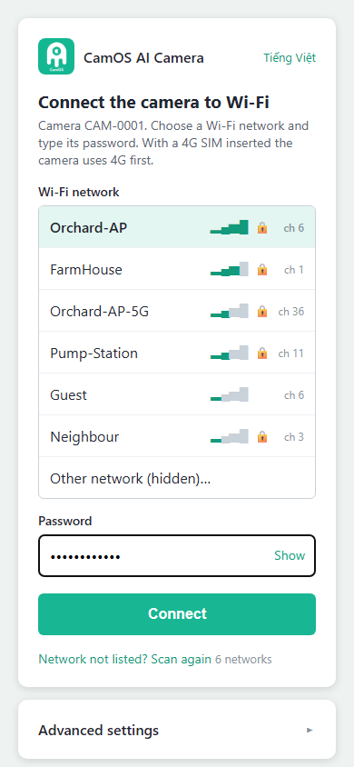
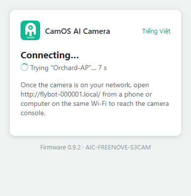
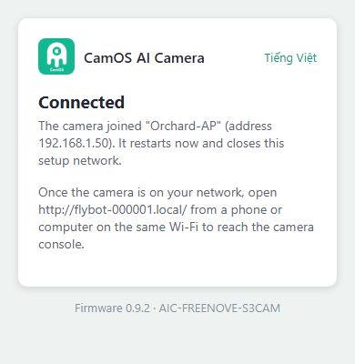
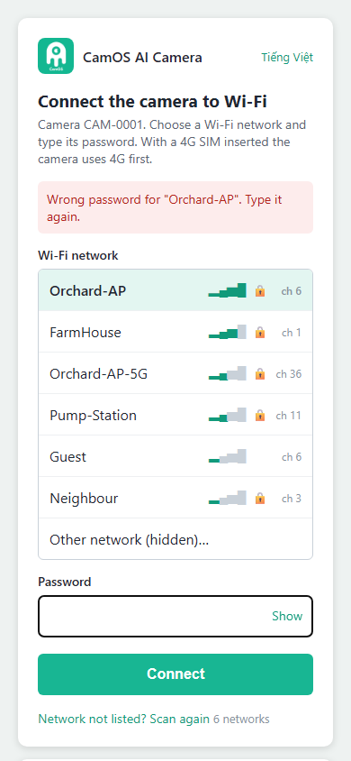

# Wi-Fi setup (the setup page, Wi-Fi `CAM-xxxx`)

The camera has no screen: you set it up from your phone. It opens its own Wi-Fi network, `CAM-xxxx` (`xxxx` = the
last 4 characters of its serial number), and a setup page on it. There you pick your Wi-Fi and type its password.

A camera with a 4G SIM in a wired 4G module goes online by itself and does not need this page (it picks the APN from
the SIM). You can still add a Wi-Fi later: the camera then prefers the Wi-Fi and keeps 4G as the backup.

## When the setup page opens

- **A new camera**: it has no network to try (no Wi-Fi set, no 4G SIM answering).
- **You ask for it**: while the camera runs, **hold the BOOT button 3 s and release it when the LED turns blue**. Every
  setting and the web page password stay. Holding it **10 s**, until the LED turns red, is a factory reset first (see
  [Starting over](#starting-over)).
- **A new Wi-Fi did not work**: the camera could not join it within about a minute; the page then says why.

The LED **breathes blue** while the setup page is open. The page closes once Connect has joined your network, or after
10 minutes without a Connect (the camera then restarts and tries its saved network again).

## Step by step

| | |
|---|---|
|  | **1. Join the camera's Wi-Fi.** On your phone, open the Wi-Fi settings and join **`CAM-xxxx`**, password **`camos1234`**. The setup page opens by itself after a few seconds. If it does not, open a browser and go to **`http://192.168.4.1`**. Your phone may warn that this Wi-Fi has no Internet: stay connected.   **2. Look at the list.** The page lists the networks the camera hears, strongest first, with signal bars, a lock for protected networks and the channel. The camera needs a **2.4 GHz** network: a 5 GHz-only network (channel 36 and up) does not work. Not listed? Tap **Scan again**, or move the camera closer to the router. |
|  | **3. Pick your network and type its password.** Tap your network. Type its password (at least 8 characters); **Show** reveals what you typed. A hidden network: tap **Other network (hidden)…** and type its name too.   **4. Tap Connect.** |
|  | **5. Wait while the camera tries.** The camera tries your network while `CAM-xxxx` stays up, and the page counts the seconds. Your phone may drop `CAM-xxxx` meanwhile (the camera moves to your router's channel): join `CAM-xxxx` again and the result shows here. |
|  | **6. Connected.** The page shows the address your router gave the camera, then the camera restarts onto your network and `CAM-xxxx` disappears. The LED blinks yellow, then gives a green blip every 5 s: the camera is online. Note the **local name** on the page (`http://flybot-xxxxxx.local/`): it opens the [web console](WEB_CONSOLE.md) from any phone or computer on the same Wi-Fi. |
|  | **If it did not work**, the page says why and you try again: *wrong password* (the field is emptied: type it again), *network not found* (move the camera closer, check the name), or *no address within 30 s* (the router did not answer: try again, check that the router accepts new devices). |

## The claim box (new cameras)

A camera that is not yet claimed in FlyBot shows its **claim QR code**, its **serial number**, its **verify code** and
its **local name** at the top of the page. Claim it in FlyBot with **Add camera**: scan the QR code, or type the serial
and the verify code ([README, section 5](../README.md#5-claim-it-on-flybot)). You can do this now or later: the serial
and the verify code are also on the web console's Device Information page.

## Language

The page is in English; **Tiếng Việt** at the top right switches it to Vietnamese. The choice is remembered on the
camera (the web console opens in the same language) and in the phone's browser.

## Advanced settings

Tap **Advanced settings** under the Wi-Fi card. Everything here already has a working value; a grey **default** badge
marks the values that came with the firmware, and an empty field means "use the default". **Most cameras need nothing
here.** **Save advanced settings** keeps the changes; they apply when you press **Connect**.

| Section | Setting | What it does |
|---|---|---|
| 4G (SIMCom A7680C) | Use 4G when a SIM is inserted | On by default. Off: the camera never dials, even with a SIM. |
| | APN | Empty: chosen from the SIM's operator ([APN.md](APN.md)). Type one only for a SIM whose operator is not in the table. |
| | SIM PIN | Only for a SIM with a PIN lock (most data SIMs have none). |
| Schedule & power | Capture interval (minutes) | How often the camera takes a photo while it runs its own schedule (default 60). A claimed camera follows the schedule set in FlyBot. |
| | Power mode | **auto** (default): without a battery divider always online (the USB-powered Wi-Fi camera); with one, always online on a full or charging battery and deep sleep between photos when it is low. **battery**: always sleep between photos. **powered**: always online. |
| | Timezone | Empty: automatic from FlyBot (the farm, the GPS position or the IP address). Type one, for example `Asia/Ho_Chi_Minh`, only to override it. |
| Device | Status LED | On by default. Off: the LED stays dark. |
| | GPS position (once a day) | On by default when the firmware has GPS. |
| | Battery / solar divider fitted | Turn it on once the dividers of [WIRING.md](WIRING.md) are wired: the camera then reads its battery and solar voltage, and **auto** power mode uses them. |
| FlyBot | FlyBot address | `https://flybot.agrhub.com`. Change it only for your own FlyBot server. |
| | Provisioning token | Only for a farm team that pre-registers cameras: leave it empty and the camera registers itself. |
| AWS IoT Core | Endpoint, certificate, private key | Only for pre-provisioned cameras ([dev/FACTORY.md](dev/FACTORY.md)). A normal camera makes its own key and gets its certificate when it registers. |

## Wi-Fi and 4G together

With both a Wi-Fi and a SIM, the camera takes the Wi-Fi (it costs the battery less) and keeps 4G as the backup:

- the Wi-Fi gives no address within 20 s (3 tries): 4G for this boot;
- the Wi-Fi has an address but the camera cannot reach the cloud for 90 s (no Internet behind the router, or the
  Wi-Fi went): 4G;
- on 4G, the camera looks for the Wi-Fi every 10 minutes and restarts onto it once it is back (not while a live viewer
  watches: a look due then runs within a minute after the viewer leaves). After a Wi-Fi without Internet, or one in
  range that gave no address (a changed password, a router that refuses the camera), it waits 20, 40, 80, then 160
  minutes; the log names the router's reason for each failed join (`disconnected (reason 15, wrong password?)`);
- 4G that carries no data for 3 minutes: back to the Wi-Fi when it is in range, else the 4G radio is switched off
  and on and the camera dials again; the second time the module is reset; only the third time does the camera restart.

On Wi-Fi the camera also asks the public resolvers 8.8.8.8 and 1.1.1.1 when the router's DNS does not answer.
While the Wi-Fi is in use, a 4G module that is always powered (no PWRKEY wired) has its radio switched off. A camera
on battery chooses again at every wake.

## Changing the Wi-Fi later

- From the web console: Configuration > Network > **Wi-Fi / TCP/IP** > Change Wi-Fi network
  ([WEB_CONSOLE.md](WEB_CONSOLE.md#network)). The camera must still be on the old network for that.
- The router or its password changed and the camera cannot reach it any more: hold **BOOT 3 s** and do the steps
  above again.

## Starting over

- **Hold BOOT 10 s**, until the LED turns red: factory reset. Every setting and the web page password go back to the
  defaults, then the setup page opens. The serial, the verify code and the FlyBot registration stay.
- Web console > Maintenance & Upgrade > **Factory reset** does the same from the browser.

## Troubleshooting

- **`CAM-xxxx` does not appear.** Check that the LED breathes blue; if not, hold BOOT 3 s. Some phones hide networks
  without Internet for a while: refresh the Wi-Fi list.
- **The setup page does not open by itself.** Open `http://192.168.4.1` in the browser (type the `http://`). Turn off
  mobile data for a moment if the phone keeps using it.
- **"FlyBot refused the registration".** This serial is registered with another verify code (the board was erased with
  the *Install* image after it was registered). The owner resets the camera in FlyBot, then it registers again.

Developers: the page's JSON API and the serial console are in [dev/CONFIG.md](dev/CONFIG.md).
