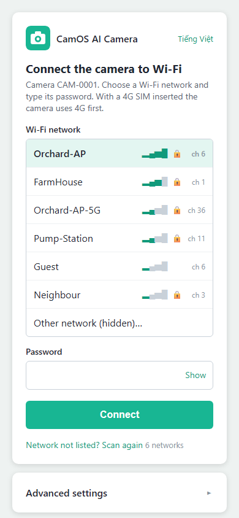
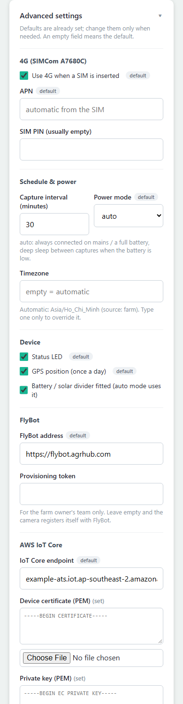

# The setup page (Wi-Fi `CAM-xxxx`)

The camera opens its own Wi-Fi network, `CAM-xxxx` (the last 4 characters of its serial number), when:

- it has no network to try (no Wi-Fi set, and no 4G SIM answering), or
- you **hold the BOOT button 3 s and release it** when the LED turns blue (every setting and the web page password stay;
  holding it **10 s**, until the LED turns red, is a factory reset first), or
- it could not join a new Wi-Fi network within about a minute (the page then says why).

The LED breathes blue while the setup page is open. It closes after 10 minutes without a Connect, or once Connect has
joined your network.

## Step by step

| | |
|---|---|
|  | 1. On your phone, join **`CAM-xxxx`**, password **`camos1234`**. The page opens by itself (else open `http://192.168.4.1`).  2. The list shows the networks the camera can hear, strongest first, with the signal bars and a lock for protected ones.  3. Tap yours. Type its password ("Show" reveals it). A hidden network: "Other network (hidden)…".  4. Tap **Connect**. The camera tries your network while `CAM-xxxx` stays up and the page shows the progress. With an address it says so, restarts onto your network and closes `CAM-xxxx`. A wrong password, a network it cannot find or no address within 30 s: the page says which, and you retype. If your phone drops `CAM-xxxx` meanwhile (it moves to your router's channel), join it again; the result shows there. |
|  | A camera that is not yet claimed in FlyBot shows its **claim QR code**, its **serial number**, its **verify code** and its **local name** (`flybot-xxxxxx.local`) at the top. Scan the QR in FlyBot ("Add camera"), or type the two codes. |

The page is in English; "Tiếng Việt" at the top right switches it to Vietnamese (remembered on the camera and in the
browser).

## Advanced settings

Everything here already has a working value; a grey "default" badge marks the values that came with the firmware. An
empty field means "use the default".

| Section | Settings |
|---|---|
| 4G | use 4G when a SIM is inserted, APN (empty = chosen from the SIM, see [APN.md](APN.md)), SIM PIN |
| Schedule & power | photo interval in minutes; power mode **auto** (without a battery divider: always online, the USB-powered Wi-Fi camera; with one: always online with a full or charging battery, deep sleep between photos when it is low), **battery** (always sleep between photos), **powered** (always online); timezone (empty = automatic) |
| Device | status LED, GPS, "battery / solar divider fitted" (turn it on once the dividers of [WIRING.md](WIRING.md) are wired) |
| FlyBot | the FlyBot address; a provisioning token (only for a farm team that pre-registers cameras: leave it empty) |
| AWS IoT Core | the endpoint and a device certificate + key (only for pre-provisioned cameras: [dev/FACTORY.md](dev/FACTORY.md)) |

With both a Wi-Fi and a SIM, the camera takes the Wi-Fi (it costs the battery less) and keeps 4G as the backup:
- the Wi-Fi gives no address within 20 s (3 tries): 4G for this boot;
- the Wi-Fi has an address but the camera cannot reach the cloud for 90 s (no internet behind the router, or the
  Wi-Fi went): 4G;
- on 4G, the camera looks for the Wi-Fi every 10 minutes and restarts onto it once it is back (not while a live viewer
  watches: a look due then runs within a minute after the viewer leaves). After a Wi-Fi without internet, or one in
  range that gave no address (a changed password, a router that refuses the camera), it waits 20, 40, 80, then 160
  minutes; the log names the router's reason for each failed join (`disconnected (reason 15, wrong password?)`);
- 4G that carries no data for 3 minutes: back to the Wi-Fi when it is in range, else the 4G radio is switched off
  and on and the camera dials again; the second time the module is reset; only the third time does the camera restart.
On Wi-Fi the camera also asks the public resolvers 8.8.8.8 and 1.1.1.1 when the router's DNS does not answer.
While the Wi-Fi is in use, a 4G module that is always powered (no PWRKEY wired) has its radio switched off. A camera
on battery chooses again at every wake.

After **Connect**, the page names the address of the camera's web page on your Wi-Fi: `http://flybot-xxxxxx.local/` (see the README, section 5).

Developers: the page's JSON API and the serial console are in [dev/CONFIG.md](dev/CONFIG.md).
