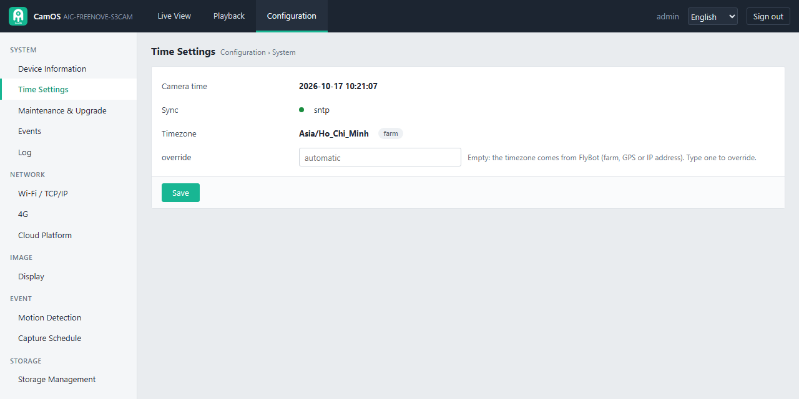
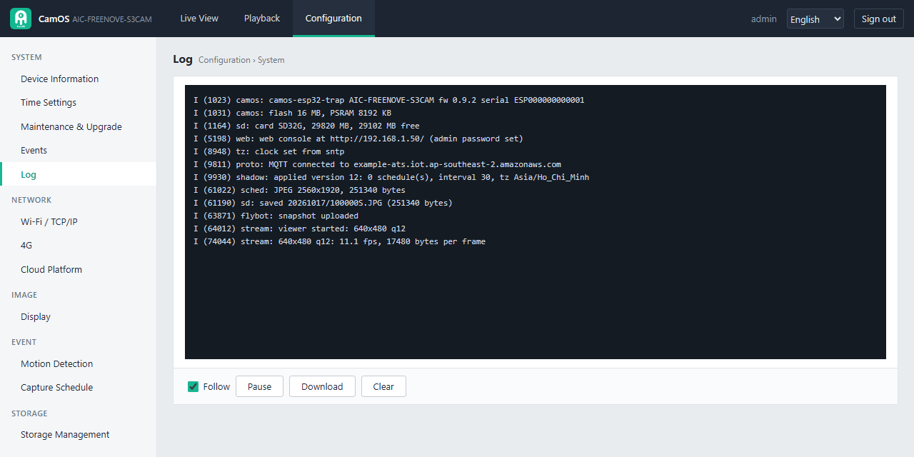
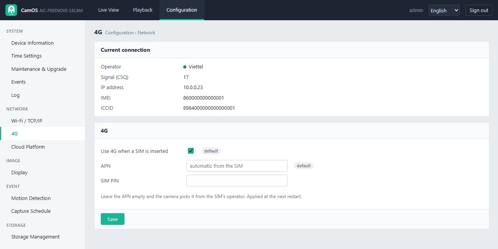
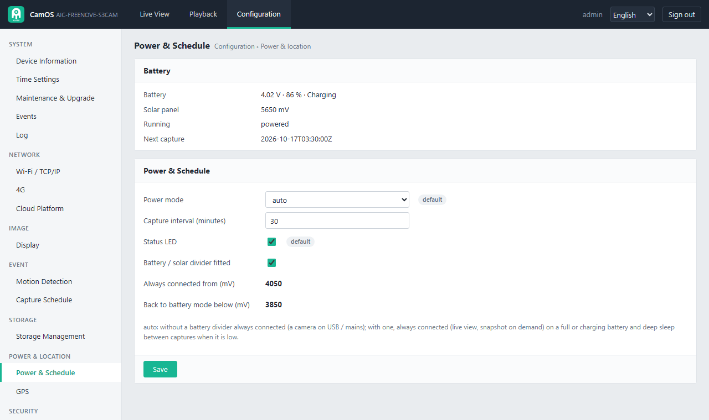
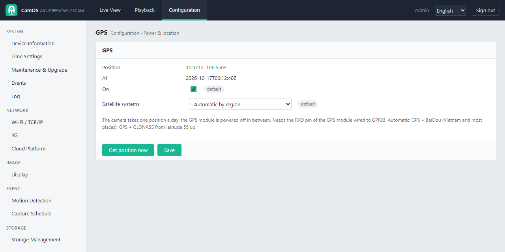

# The camera's web page (web console, firmware 0.9.2)

Every camera has its own web page for the live picture, the photos on its memory card and all its settings. This page
goes through it screen by screen. *The pictures inside the screenshots are drawings of a sticky card from a mock camera
with made-up values, not camera photos.*

- [Opening the web page](#opening-the-web-page) · [First visit: the admin password](#first-visit-the-admin-password)
- [Live View](#live-view) · [Playback](#playback)
- Configuration: [System](#system) · [Network](#network) · [Image](#image) · [Event](#event) · [Storage](#storage) ·
  [Power & location](#power--location) · [Security](#security)
- [Language](#language) · [Technical notes](#technical-notes)

## Opening the web page

1. Put the phone or computer on **the same Wi-Fi as the camera**.
2. Open **`http://flybot-xxxxxx.local/`**, where `xxxxxx` is the last 6 characters of the serial number in lower case
   (serial `ESP000000000001` gives `flybot-000001.local`). The setup page shows the exact name when it connects.
3. Windows, macOS, iPhone and Linux open `.local` names; many Android browsers do not. There, open
   `http://<camera IP>/`: the IP is in your router's list of devices (the camera appears as `flybot-xxxxxx`), on the
   setup page right after Connect, and on the serial console (`info`).

The web page works on the local Wi-Fi only, not over 4G and not from the Internet (from anywhere, use FlyBot). It is
served while the camera is awake: always in powered mode; in battery mode during the awake window after a photo, and
for as long as the page stays open (it pings the camera every 30 s; the camera sleeps 2 minutes after the page is
closed).

## First visit: the admin password

The first visit **activates** the camera: choose the admin password (8-64 characters, letters and digits) and type it
twice. Later visits ask for it. The user name is always `admin`.

- 5 wrong passwords lock the sign-in for 5 minutes.
- **Forgot it?** While the camera runs, hold the BOOT button **10 s**, until the LED turns red. That is a factory
  reset: the settings and the password go back to the defaults and the setup page opens (join your Wi-Fi again,
  [PORTAL.md](PORTAL.md)); the next visit sets a new password. The serial and the FlyBot registration stay.
- **Sign out** at the top right ends the session; a session also ends after 30 minutes without use.

The top bar has three parts: **Live View**, **Playback** and **Configuration**, plus the language menu and Sign out.

## Live View

The live picture of the camera, about 5-10 frames a second on a good Wi-Fi.

| Control | What it does |
|---|---|
| Play / Stop | starts and stops the live picture (it also stops while the browser tab is hidden) |
| Save picture | downloads the frame on screen as a JPEG |
| Send to FlyBot | takes a full-size photo now, uploads it to FlyBot (FlyBot counts the flies on it) and keeps it on the SD card |
| Size menu (VGA 640×480 …) | the live picture size, 320×240 to the sensor's largest; larger is sharper but slower |
| Quality menu | High, Standard or Smooth (smaller frames, smoother on a weak Wi-Fi) |
| Full screen | the picture alone on the screen |

On the picture: the camera's clock and name (top left), the size, frame rate and frame size (top right), and a red
**MOTION** badge while motion detection sees movement. The **Status** panel on the right shows the network, the cloud
connection, the battery, the power mode, the next scheduled photo, motion detection and the SD card.

One viewer at a time: a second viewer sees a still picture every 2 s until the first one leaves. While someone watches
from FlyBot (cloud live view), this page shows "busy" instead.

## Playback

The photos on the microSD card (or the USB drive), by day.

1. Pick a **day** on the left (with the number of photos).
2. The **time line** shows a mark for every photo of that day; motion photos are red. Click a mark, or a row in the list
   under it (time, trigger, size).
3. The viewer shows the photo. **Previous / Next** step through the day, **Download** saves it, **Delete** removes it,
   **Delete the day** removes the whole day.

The trigger tells why the photo was taken: **Schedule**, **On demand** (Send to FlyBot, or FlyBot asked), **Boot**,
**Motion**.

## Configuration

Configuration has a menu on the left, in groups. A grey **default** badge next to a setting means it still has the
value that came with the firmware. **Save** under each panel keeps that panel's settings; some say "a restart is needed"
and offer to restart the camera.

### System

**Device Information**

Read only, refreshed every 5 s: model, **serial number** and **verify code** (to claim the camera in FlyBot), firmware
version and build date, uptime, free memory, camera time, LED state, sensor and photo size, SD card; the network
(Wi-Fi or 4G, signal, IP, local name, public IP, MAC); the cloud (connected, server, certificate, claimed or not); the
battery, the solar panel, the power mode and the GPS position.

**Time Settings**

The camera's clock, where it came from (`sntp` Internet time, `flybot`, `modem` 4G network time, `gps`, or `rtc` kept through deep sleep) and the timezone with its source
(the farm in FlyBot, the GPS position or the IP address). Leave **override** empty to keep the automatic timezone;
type one (for example `Asia/Ho_Chi_Minh`) only if the automatic one is wrong. Schedules and photo names use this time.

**Maintenance & Upgrade**

| Panel | What it does |
|---|---|
| Firmware upgrade | shows the running version; **Check & upgrade** asks FlyBot for a newer firmware, downloads it, checks it and restarts into it |
| Upload a firmware file | installs a firmware file from your computer: the `-update.bin` of a [release](https://github.com/agrhub/camos-esp32-trap/releases) (or `camos-esp32.bin` of your own build), optionally with its SHA-256 from the release page. It takes about 15 s over Wi-Fi; the camera restarts into it. A firmware that cannot reach the network or this page goes back to the previous one by itself at the next restart. |
| Maintenance | **Restart**, and **Factory reset**: every setting and the admin password back to the defaults; the serial, verify code, certificate and FlyBot registration stay |

**Events**

The last 64 events since the camera started: photos taken and uploaded, motion, SD card, firmware, settings saved.
Motion events have a red dot. FlyBot keeps the full history.

**Log**

The camera's live log, as on the serial console. **Follow** keeps the newest line in view, **Pause** stops the scrolling,
**Download** saves it as a text file (send it along when you report a problem), **Clear** empties the screen.

### Network

**Wi-Fi / TCP/IP**

| Panel | What it does |
|---|---|
| Current connection | the Wi-Fi name, signal (dBm) and channel, IP address, local name (`flybot-xxxxxx.local`), public IP, mask, gateway, MAC |
| TCP/IP | **Automatic (DHCP)** (default) or **Static**: IP, mask, gateway and DNS. Applied at the next restart. A wrong static address makes the camera unreachable: hold BOOT 3 s for the setup page, or type `set ipMode 0` on the serial console. |
| Change Wi-Fi network | the networks the camera hears (click one, or **Scan**), the password, **Connect**. The camera restarts onto the new network; if it cannot join it, the setup network `CAM-xxxx` comes back after about a minute. |

**4G** (only on a camera built with the 4G module)

| Setting | What it does |
|---|---|
| Current connection | on 4G: the operator, the signal (CSQ 0-31; under about 10 is weak), the IP, the module's IMEI and the SIM's ICCID; on Wi-Fi: "not on 4G now" |
| Use 4G when a SIM is inserted | on by default; off: the camera never dials |
| APN | empty (default): chosen from the SIM's operator ([APN.md](APN.md)); type one only for an operator that is not in the table |
| SIM PIN | only for a SIM with a PIN lock |

Applied at the next restart.

**Cloud Platform**

| Claimed | Not yet claimed |
|---|---|
|  |  |

The FlyBot connection: connected or not, the device certificate, the thing name, the live view channel and its state
(ready, a viewer is watching). A camera that is not yet claimed shows its claim QR code, serial and verify code here.
**FlyBot address** and **IoT Core endpoint**: usually nothing to change: the camera registers itself. Change them only
when told to (your own FlyBot server).

### Image

**Display**

The live picture next to every image control: changes show on the picture at once. **Save** keeps them for every photo,
**Restore** goes back to the saved values, **Defaults** to the factory values. Leaving the page without saving restores
the saved values. Settings sent from FlyBot override the ones set here.

| Group | Settings |
|---|---|
| Picture | brightness, contrast, saturation, sharpness, orientation (flip, mirror: turn the picture if the camera hangs upside down), white balance (auto, sunny, cloudy, office, home), effect, noise reduction |
| Exposure & gain | exposure (auto or a manual value), exposure compensation (brighter / darker in auto), gain (auto or manual), gain ceiling (how bright auto may push a dark scene; 32× default), night mode for live view (slower, brighter in a very dark place; photos are not affected) |
| Capture | JPEG quality of the photos, capture resolution (largest by default: 2560×1920 on the OV5640) |

For a sticky card the defaults are a good start. Set the orientation so the card is upright, then check focus and
brightness on the live picture.

### Event

**Motion Detection** (only while the camera is in powered mode)

| Setting | What it does |
|---|---|
| Enable motion detection | on / off |
| Status, Change now | whether it is watching, and a meter of how much of the area changes now against the trigger level |
| Sensitivity | 1-100: higher reacts to smaller changes |
| Wait between triggers (s) | at most one trigger per this many seconds |
| Detection area | draw it on the picture: drag to draw, drag the corner and edge handles to resize, drag inside to move; **Whole picture** resets it |
| On motion | **Save the picture to the SD card** and/or **Capture a full photo and send it to FlyBot** |

It runs only when the camera is in powered mode (a battery camera sleeps), and pauses while someone watches through
FlyBot. It compares pictures; it does not recognise insects, people or objects (the counting is done by FlyBot).

**Capture Schedule**

Who sets the schedule and when the next photos are due.

- **Set by FlyBot**: a claimed camera follows the schedule set in FlyBot; it is shown here read only. Change it in FlyBot.
- **Set by this camera** (not claimed yet, or no schedule from FlyBot): **Capture interval** in minutes and the
  **capture window** (From - To, camera time; From = To means all day; a window that ends before it starts crosses
  midnight). For a sticky card, daylight hours are enough (the camera has no infrared light).
- **Next captures**: the next 8 photo times.

An unclaimed camera takes at most one photo an hour. In battery mode the camera sleeps between photos.

### Storage

**Storage Management**

| Panel | What it does |
|---|---|
| Card | the microSD card: name, capacity, used, free, the number of photos (a link to Playback), **Format the card** (erases every photo) |
| Storage Management | **Save every photo to the card** (on by default): every photo is also kept on the card, even when the upload fails. Below 5 % free the oldest day is deleted. |
| USB port | what the board's native USB port does (applied after a restart). **Automatic** (default): plugged into a computer, the camera is a USB drive (its SD card) and a webcam; with a USB flash drive on the port, the photos go to the drive instead of the card. **Drive**, **Webcam** or **Off** (USB log console) choose one. See [Native USB port](#native-usb-port-card-reader-webcam-or-usb-drive). |

Use a FAT32 microSD card (32 GB is plenty). Photos are named `/DCIM/YYYYMMDD/HHMMSSx.JPG` (x: S schedule, R on demand,
B boot, M motion).

### Power & location

**Power & Schedule**

| Setting | What it does |
|---|---|
| Battery panel | battery voltage, charge and charging state, solar panel voltage, the mode the camera runs in now, the next photo |
| Power mode | **auto** (default): without a battery divider always online (a camera on USB / mains); with one, always online on a full or charging battery (live view and photos on demand work), and deep sleep between photos when the battery is low. **battery**: always sleep between photos (longest battery life; the web page and live view only in the awake window). **powered**: always online. |
| Capture interval (minutes) | as on the Capture Schedule page |
| Status LED | on / off |
| Battery / solar divider fitted | on once the dividers of [WIRING.md](WIRING.md) are wired: the camera reads its battery and solar voltage |
| Always connected from / Back to battery mode below (mV) | the battery levels where **auto** switches (4050 / 3850 mV) |

**GPS** (only on a camera built with GPS)

| Setting | What it does |
|---|---|
| Position, At | the last position (a link to the map) and when it was taken; FlyBot puts the trap on its map with it |
| On | on by default; the camera takes one position a day and powers the GPS module off in between |
| Satellite systems | which satellites the GPS module uses. **Automatic by region** (default): GPS + BeiDou (Vietnam and most places), GPS + GLONASS from latitude 55° up. Or fix it to GPS + BeiDou, GPS + GLONASS, GPS only or BeiDou only. Needs the module's RXD pin wired to GPIO3 (as in [WIRING.md](WIRING.md)); without that wire the module keeps its own choice. |
| Get position now | looks for satellites now (up to 2 minutes; outdoors, with a clear view of the sky) |

The first position after a long time off can take a few minutes; indoors there is usually none.

### Security

**Account**

Change the admin password: the current one, then the new one twice (8-64 characters, letters and digits). Forgot it:
see [First visit](#first-visit-the-admin-password).

## Language

The web page is in English; the language menu at the top right (also on the sign-in form) switches it to **Tiếng
Việt**. The choice is remembered on the camera (the setup page uses it too) and in the browser.

| Xem trực tiếp | Phát hiện chuyển động |
|---|---|
|  |  |

## Technical notes

The rest of this page is for the curious and for developers: how the live picture, the image settings, the SD card,
the USB port, motion detection and the firmware upload work, with the measurements behind them. The local API is in
[dev/CONFIG.md](dev/CONFIG.md). Sessions are a random `HttpOnly; SameSite=Strict` cookie, 30 minutes idle; every POST
needs the header `X-Requested-With: camos`. The password is kept as a salted, iterated SHA-256 in NVS.

## Live picture on the LAN (MJPEG)

`GET /api/stream?w=640&h=480&q=12` answers `multipart/x-mixed-replace;boundary=camosframe`, one JPEG per part with its
`Content-Length`. Sizes: 320x240, 640x480 (default), 800x600, 1024x768, 1280x720, 1280x1024, 1600x1200, 1920x1080,
2048x1536 (within the sensor's maximum; above 1600x1200 at the photo XCLK); JPEG quality
8..40 (lower = better; the page offers 10 high, 12 standard, 20 smooth). The stream runs in a task of its own (async
HTTP request), so the console keeps answering while it plays, and Wi-Fi power save is off while it plays.

- **One viewer at a time.** A second viewer gets `409 {"error":"BUSY","message":"another viewer is watching: one live
  picture at a time"}`; the page then shows a still every 2 s (`GET /api/frame.jpg`) with that message and takes the
  stream over as soon as it is free.
- The page closes the stream while its tab is hidden and opens it again when the tab comes back.
- A scheduled or on-demand capture takes the camera for a few seconds (full-size JPEG); the stream carries on after.
- A stream ends after 30 minutes, when the viewer goes away, or when a FlyBot viewer connects over the cloud (KVS
  WebRTC, [dev/LIVE_VIEW.md](dev/LIVE_VIEW.md)): the camera then belongs to the H.264 encoder, and `/api/stream`
  answers `409 BUSY` ("live view over KVS is running") until that viewer leaves and while a `live.start` window is open.
  `/api/status` has the cloud live view's state under `live` (`joined`, `viewer`, frame rate).

Measured on the Freenove ESP32-S3 CAM (OV5640, XCLK 10 MHz), Wi-Fi at -47 dBm, laptop on the same access point, 16 Oct 2026
(firmware 0.4.0, `/api/stream` read for 10-12 s by a script, quality 12):

| Size | Frame rate | Frame size, dark room | Frame size, bright noisy picture (gain 30) |
|---|---|---|---|
| 320x240 | 11.1 fps | 2.1 KB | not measured |
| 640x480 | 11.1 fps (browser: 10.7-11.2 fps) | 6.6 KB | 17.5 KB (1.6 Mbit/s) |
| 800x600 | 11.0 fps | 11.3 KB | not measured |
| 1280x720 | 12.7 fps | 18.7 KB | 63.5 KB (6.4 Mbit/s) |
| 1600x1200 | 2.2 fps | 38.2 KB | not measured |

Up to HD the sensor sets the pace (the network carried 6.4 Mbit/s); UXGA drops to the OV5640's slow full-size mode.
With motion detection running at the same time VGA dropped to about 9 fps. A daylight scene was not available (the
measurement ran at night): frame sizes of a lit scene are still to be measured.

Measured again on 18 Oct 2026 (firmware after 0.6.0), motion detection on, an indoor scene, another Wi-Fi (ping to the
camera 30-150 ms), 20 s per size; `camera` and `send` are the stream's own log (`stream: ... camera N ms, send N ms`):

| Size, q12 | 0.6.0 | XCLK 10 MHz | XCLK 20 MHz (now) | Frame | camera / send per frame (20 MHz) |
|---|---|---|---|---|---|
| 320x240 | | 3.1 fps | 8.4 fps | 3 KB | 98 ms / 1 ms |
| 640x480 | 0.4 fps | 4.4 fps | 8.6-9.3 fps | 8-10 KB | 97-107 ms / 2-20 ms |
| 800x600 | 0.4 fps | 4.4 fps | 9.2-9.4 fps | 12-13 KB | 100-106 ms / 3 ms |
| 1024x768 | 0.4 fps | 2.5 fps | 6.7-8.0 fps | 21 KB | 77-117 ms / 8 ms |
| 1280x720 | 0.4 fps | 5.1 fps | 9.5-12.0 fps | 22-23 KB | 71-90 ms / 6-39 ms |
| 1600x1200 | 0.3 fps | 1.5 fps | 3.2 fps | 55 KB | 194-293 ms / 45-74 ms |

- 0.6.0 restarted the sensor for nearly every frame: motion detection chose its frame size before it held the camera,
  so it asked for the size the stream had just replaced, and the two took turns (fixed: the size is chosen under the
  camera lock).
- With the default 5,760-byte TCP send buffer a frame took 72-755 ms to send on this Wi-Fi; with 23,040 bytes
  (Freenove preset) 1-40 ms, so the sensor sets the pace again.
- The 20 MHz XCLK of that table cost the camera's own Wi-Fi (next section): the stream and the live view now run the
  sensor at 12 MHz (`CAMOS_LIVE_XCLK_MHZ`; photos keep 10 MHz). The sensor then gives a 640x480 frame about every 146 ms
  (6.8 fps; 10 MHz: 5.6 fps, 20 MHz: 12-14 fps; frames taken by the camera with nothing sent).
- While a cloud viewer watches, the stream is refused (`409`), as before.

### Camera clock and Wi-Fi

The OV5640's XCLK (and the camera bus it clocks) disturbs the board's own 2.4 GHz Wi-Fi from 16 MHz up. Measured on 19 Oct
2026 on one Wi-Fi (the owner's home network, channel unknown), camera in place, from a PC on the same network: ping (30
pings) and an HTTP download of the 93 KB console page (3 times) while the camera kept the sensor running and took
frames without sending them, cases interleaved:

| Sensor | Ping round trip | HTTP from the camera |
|---|---|---|
| off (clock stopped) | 62-64 ms, 0 % loss | 366-914 KB/s |
| JPEG 640x480, XCLK 10 MHz | 50-63 ms | 350-919 KB/s |
| JPEG 640x480, XCLK 12 MHz | 63-71 ms | 584-1,642 KB/s |
| JPEG 640x480, XCLK 16 MHz | 110-121 ms, up to 3 % loss | 59-147 KB/s |
| JPEG 640x480, XCLK 20 MHz | 99-346 ms | 5-183 KB/s |
| YUV422 320x240 (H.264 path), 12 MHz | 54-59 ms | 626-1,340 KB/s |
| YUV422 320x240, 20 MHz | 275-528 ms, up to 6 % loss | 7-14 KB/s |

During a live session at 12 MHz (Wi-Fi power save off) the camera answered pings in 3-21 ms with no loss. Two more
things made it worse before: esp32-camera on the S3 leaves the XCLK output running after the camera is switched off, so
the last clock kept radiating with the sensor asleep (the firmware now stops the pin), and since 0.6.1 motion detection
kept a 20 MHz preview running all the time. That Wi-Fi also has bad spells of its own (25-60 % loss with the sensor off),
so compare cases taken close together.

## Image settings

All under the shadow `video.image` ([dev/PROTOCOL_ADDITIONS.md](dev/PROTOCOL_ADDITIONS.md) section 3), so the console and FlyBot use the same keys:
brightness, contrast, saturation, sharpness, orientation (normal, mirror, flip, both), white balance (auto, sunny,
cloudy, office, home), effect (none, negative, black & white, red, green, blue tint, sepia), exposure (auto or manual
0..1200), exposure compensation (-5..5 on the OV5640), gain (auto or manual 0..30), gain ceiling (2x..128x), noise
reduction (0..8), night mode for streams (`nightMode`, off by default), plus `capture.jpegQuality`. `POST /api/image {"image":{...},"save":false}` previews on the running
camera only; `save` true (default) persists and publishes `reported`; `{"restore":true}` goes back to the saved values.
Leaving the page with unsaved changes restores the saved values. A later shadow from FlyBot overrides local values.

Exposure in dim light (18 Oct 2026, evening indoor light, mean luma 0-255 of a 640x480 preview / of a photo):

| | gain ceiling 8x (2) | 32x (4, default) | 64x (6) |
|---|---|---|---|
| stream and live view, XCLK 20 MHz | 53 | 111 | 134 |
| stream, XCLK 10 MHz | 76 | 135 | |
| photo (10 MHz) | 83 | 138 | 140 |

Firmware 0.6.1 and earlier gave the OV5640 a gain ceiling of 0.125x whatever the setting (esp32-camera writes the
value as is into the sensor's 1/16-step register), so the gain stayed at 1.2x and the same scene came out at 5 on the stream at 20 MHz and 9 at 10 MHz
(photo not measured). Exposure compensation changed nothing there: the exposure was already the whole frame time. At
20 MHz a frame is half as long, so the stream needs about twice the gain of a photo; the auto exposure target is about
135. A camera that saved gain ceiling 2 keeps it: set 4 in the console or FlyBot.

In a dark room even 32x is not enough at a stream's frame time. The OV5640's night mode with a limit of 4 frame times
lets the auto exposure stretch the frame: `nightMode` turns it on for the streams (live view and web console, not
photos). Firmware 0.6.2 had it always on; since 0.6.3 it is off by default, because the sensor's AEC fills the exposure
before it raises the gain, so even ordinary room light ran at 4 frame times. Measured on 19 Oct 2026 in the evening
(LED tubes), sensor registers through the serial console's `cam regs`, frame rate at the viewer:

| | night mode on (0.6.2) | off (0.6.3 default) |
|---|---|---|
| exposure, gain | 4.00 frames, 6.8x | 1.00 frame, 24-28x |
| one 640x480 JPEG frame from the sensor (`frame`) | 1171 ms | 73 ms |
| live JPEG 640x480 | 2.1 fps | 5.4 fps |
| live JPEG 800x600 / 1280x720 | | 6.7 / 5.6 fps |
| live JPEG 1600x1200 | 0.6 fps | 1.8 fps |

The long exposure also smeared anything that moved. Turn `nightMode` on only for a trap that is really dark; measured
in a real live session on 19 Oct 2026 before dawn (mean luma at the viewer, frame rate at the viewer):

| | without night mode | with night mode |
|---|---|---|
| H.264 320x240 | 3 (Y level 7-10 into the encoder: black), 5 fps | 42-45, 1.2 fps |
| JPEG 640x480 | 28, 7.1 fps | 46-96, 1.7-2.2 fps |
| JPEG 1600x1200 | 19-28, 1.5 fps | 71-90, 0.6 fps |

The night mode used to change nothing because esp32-camera sets its exposure limit (0x3a02/0x3a03, 0x3a14/0x3a15) to
exactly one frame; with `nightMode` the firmware raises it to 4 frames.

White balance "auto" uses the OV5640's simple AWB (0x5183 bit 7) since 0.6.3. The advanced AWB, with its generic
calibration, settled under the same LED tubes at R 1.38x / B 1.44x over G and the picture went pink (white walls
lavender); simple AWB gave R 1.17x / B 1.24x and natural whites, checked by eye on the live view.

## microSD card

Freenove ESP32-S3 CAM: SD_MMC 1-bit (CLK 39, CMD 38, D0 40), FAT32, mounted at boot (`CAMOS_SD`, off on the AI-Thinker
ESP32-CAM whose card pins are the flash LED, the button and the battery ADC). With "save every photo" on (default)
every capture is written as `/DCIM/YYYYMMDD/HHMMSSx.JPG` (x: `S` schedule, `R` on demand, `B` boot, `M` motion), also
when the upload fails. Below 5 % free the oldest day is deleted. The card's API: [dev/CONFIG.md](dev/CONFIG.md).

## Native USB port: card reader, webcam or USB drive

The Freenove board has two USB-C ports. The CH340 port is the serial console and flashing in every mode. The native
USB port (USB OTG) follows the **USB port** setting on the Storage page (or the serial command
`usb auto|storage|webcam|off`), applied after a restart. The default, **Automatic**, needs nothing: plug the native port
into a computer and the camera is both a drive and a webcam; plug a USB drive into it instead and the camera saves its
photos on the drive.

| Setting | What the computer sees | Notes |
|---|---|---|
| Automatic (default) | the drive and the webcam below, together; with a USB drive on the port, nothing (the camera is the drive's host) | A USB charger alone changes nothing: only a computer that connects takes the card. See *A USB drive for the photos* below. |
| Off | the USB serial/JTAG log console, as before | |
| Drive | a USB drive "FlyBot Trap camera SD": the microSD card | While the computer has the card the camera does not save photos to it (uploads to FlyBot go on). Eject the drive on the computer before unplugging; the camera takes the card back on eject, unplug, or 10 s without USB activity. |
| Webcam | a UVC camera "FlyBot trap camera", MJPEG, no driver needed | 640x480 by default, also 800x600, 1280x720, 1920x1080, 2560x1920 (5 MP, the photo size) and 320x240. Measured on 21 Oct 2026: about 6 fps at 640x480, 4 fps at 1280x720, 1.9 fps at 1920x1080 and 1.3 fps at 2560x1920 (the sensor's pace; at the two large sizes full-speed USB too): the large sizes are for stills. While an app streams, scheduled photos and the live view wait; the camera is released 2 s after the app closes. |

The camera does not deep sleep while a computer uses the port. The setup portal does not start the USB port. The
AI-Thinker ESP32-CAM has no native USB port. Measured with both parts on (21 Oct 2026): the drive wrote 2 MB at about
650 KB/s while the webcam streamed 640x480 at about 6 fps.

### A USB drive for the photos

In **Automatic**, a USB drive (FAT32) on the native port replaces the microSD card as the photo storage: photos,
Playback and the Storage page use it while it is there, and the card again once it is pulled out. The board's USB-C
port gives the drive no power, so it goes through an OTG cable with a 5 V input (or a USB-A socket fed by the 5 V rail).
To read the photos, pull the drive out and plug it into a computer (`DCIM/YYYYMMDD/`, as on the card); the card stays
in the board.

The camera tells what is on the port from the D+ line, so nothing has to be chosen:

- at boot: a drive makes the port its host; a computer or nothing, the drive + webcam above;
- drive pulled out: the camera reads the line every second; the drive plugged back in is mounted again, a computer
  plugged in restarts the camera as its drive + webcam (about 3 s);
- drive + webcam with no computer using it for 10 s (never connected, or the cable pulled): a drive plugged in restarts
  the camera as its host. A computer still on the cable is never disturbed.

Tested on 21 Oct 2026 with a 32 GB SanDisk Ultra Fit: mounted 1.6 s after boot; every switch above both ways; the
photos read on Windows. Formatting is a card operation: format a drive on a computer. A drive that fails its first
enumeration right after power-up (some do) is tried again every 10 s.

## Motion detection

Runs while it is enabled **and** the effective power mode is powered (a battery camera deep sleeps; a board without a battery divider
is powered in `auto`). About twice a second it decodes the
preview picture at 1/4 or 1/8 scale (80..200 pixels across), turns it grey and compares it with a running average of
the scene inside the detection area: a pixel counts as changed above 12..51 grey levels, motion is 1..30 per mille of
the area changed (both from the sensitivity, 100 = most sensitive). A change of 70 % of the whole picture at once
(lights, exposure) is taken as a new scene, not motion. On motion, at most once per cooldown: the picture goes to the
SD card (`M`), the protocol event `motion` is published, and with "capture a full photo" a full-size photo is captured
and uploaded (FlyBot sees trigger `rpc`, the `capture` event says `motion`). The algorithm is host-tested
(`tests/test_motion.c`). No person or object recognition on the camera: the ESP32-S3 has no AI accelerator; the
counting stays in the cloud.

## Firmware upload

Configuration > Maintenance & Upgrade > Upload a firmware file: pick the `-update.bin` of a release (or
`camos-esp32.bin` of your own build), optionally paste its SHA-256 from the release page, Upload & install. The camera
writes it to its second firmware slot, checks it, then restarts into it. The new image marks itself
valid on its first MQTT connection or on the first signed-in console request; otherwise the bootloader rolls back at
the next restart. Measured on 16 Oct 2026: a 1.43 MB image uploaded and installed in 13 s over Wi-Fi.

## What this camera cannot do (hardware)

- **RTSP / ONVIF / RTMP video, continuous video recording, H.264 at large sizes**: the ESP32-S3 has no video encoder;
  the camera streams and stores JPEG pictures. The cloud live view in FlyBot uses a small software H.264 stream
  (320x240, 5-8 fps measured) or the sensor's JPEG pictures over a WebRTC data channel (640x480 at up to 15 fps
  measured) through KVS ([dev/LIVE_VIEW.md](dev/LIVE_VIEW.md)).
- **Audio**: no microphone or speaker on the board.
- **On-screen text burned into the photos and privacy masks**: would need a decode and re-encode of every 5 MP JPEG;
  the clock and name are drawn by the browser over the live picture only.
- **Person / vehicle detection on the camera**: no AI accelerator; motion detection is frame difference.
- **Several user accounts and roles**: one admin account.
