# The camera's web page (web console, firmware 0.5.0)

`http://flybot-xxxxxx.local/` on the same Wi-Fi (mDNS; `xxxxxx` = the last 6 characters of the serial, lower case), or
`http://<camera IP>/` (the IP is in the boot log, the serial `info` and the router, which lists the camera as
`flybot-xxxxxx`). Android browsers often do not resolve `.local`: use the IP there. Served while the camera is
awake: always in powered mode; in battery mode during the awake window, and for as long as the page is open (it pings
the camera every 30 s, also on the sign-in form; the camera sleeps 2 minutes after the page is closed).
Not over 4G. English by default, Vietnamese from the language menu (remembered on the camera and in the browser).

## Sign-in

The first visit **activates** the camera: it asks for the admin password (8-64 characters, letters and digits) and keeps
a salted, iterated SHA-256 of it in NVS. Later visits sign in with it. 5 wrong passwords lock sign-in for 5 minutes.
Forgot it: while the camera runs, hold the BOOT button 10 s (until the LED turns red). That is a factory reset: the
settings and the password go back to the defaults and the setup page opens; the next visit sets a new password. The
registration with FlyBot stays. Holding it 3 s and releasing (LED blue) only opens the setup page, password kept.

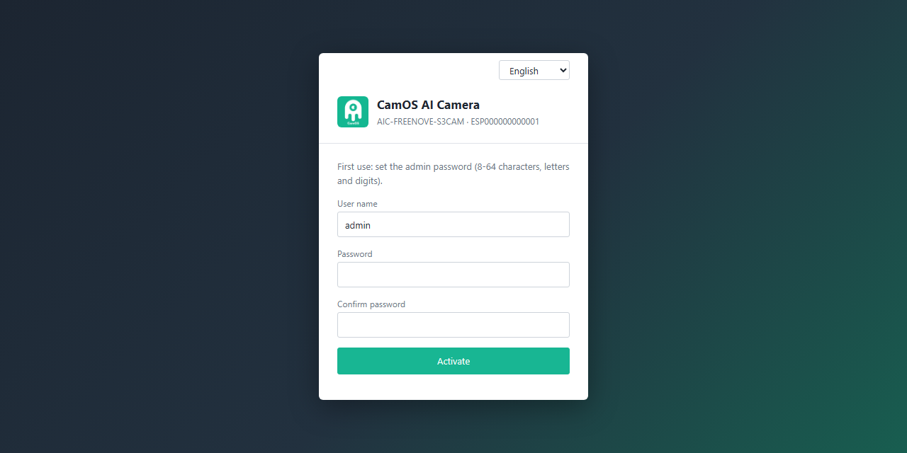

Nothing of the console is shown before activation / sign-in: a camera that was never activated shows only the
activation form. Sessions are a random `HttpOnly; SameSite=Strict` cookie, 30 minutes idle; every POST needs the header
`X-Requested-With: camos` (no cross-site forms).

## Pages

| Top bar | Page | What it does |
|---|---|---|
| Live View | | MJPEG live picture (below), size QVGA..UXGA and quality, on-screen camera clock and name, frame rate and frame size, a MOTION badge while motion is detected, Save picture (the frame on screen as a JPEG download), Send to FlyBot (full-size capture + upload, also on the SD card), full screen; status side panel. |
| Playback | | Photos on the microSD card by day: day list, 24-hour time line with a mark per photo (motion photos in red), list with time / trigger / size, viewer, previous / next, download, delete a photo or a whole day. |
| Configuration | System > Device Information | model, serial, verify code, firmware, uptime, memory, camera time, LED, sensor, SD card; network, cloud, battery. |
| | System > Time Settings | camera time, clock source, timezone and where it came from, manual override. |
| | System > Maintenance & Upgrade | check FlyBot for a newer firmware (`GET /api/device/ota`), **upload a firmware file** (`.bin`, optional SHA-256), restart, factory reset. |
| | System > Events | the last 64 events since the start (captures, motion, SD card, firmware, settings). |
| | System > Log | the live log (ring buffer of 32 KB), pause, download, clear. |
| | Network > Wi-Fi / TCP/IP | current connection, **DHCP or static address** (IP, mask, gateway, DNS), scan table, change network. |
| | Network > 4G | modem state, APN (automatic from the SIM by default), SIM PIN. |
| | Network > Cloud Platform | FlyBot / IoT Core state, claim QR while unclaimed, FlyBot address and IoT endpoint. |
| | Image > Display | live picture next to every image control (below); changes show at once, Save keeps them, Restore goes back to the saved values, Defaults. |
| | Event > Motion Detection | enable, sensitivity, cooldown, detection area drawn on the live picture, actions (save to SD, capture + upload), live change meter against the trigger level, trigger count, last motion. |
| | Event > Capture Schedule | who sets the schedule (FlyBot detections or this camera), local interval and capture window, the next 8 captures. |
| | Storage > Storage Management | card name, capacity, used / free, "save every photo to the card", format. |
| | Power & location > Power & Schedule, GPS | power mode, interval, LED, battery divider, GPS fix. |
| | Security > Account | change the admin password. |

## Screenshots

*The pictures inside these screenshots are drawings of a sticky card from a mock camera with made-up values, not
camera photos.*

| Live View | Playback |
|---|---|
| 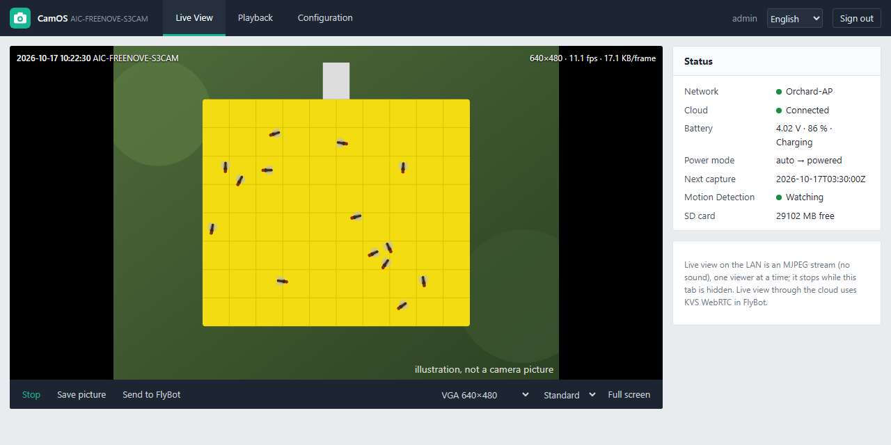 | 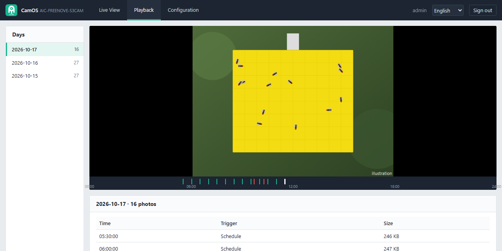 |
| **Image (Display)** | **Motion Detection** |
| 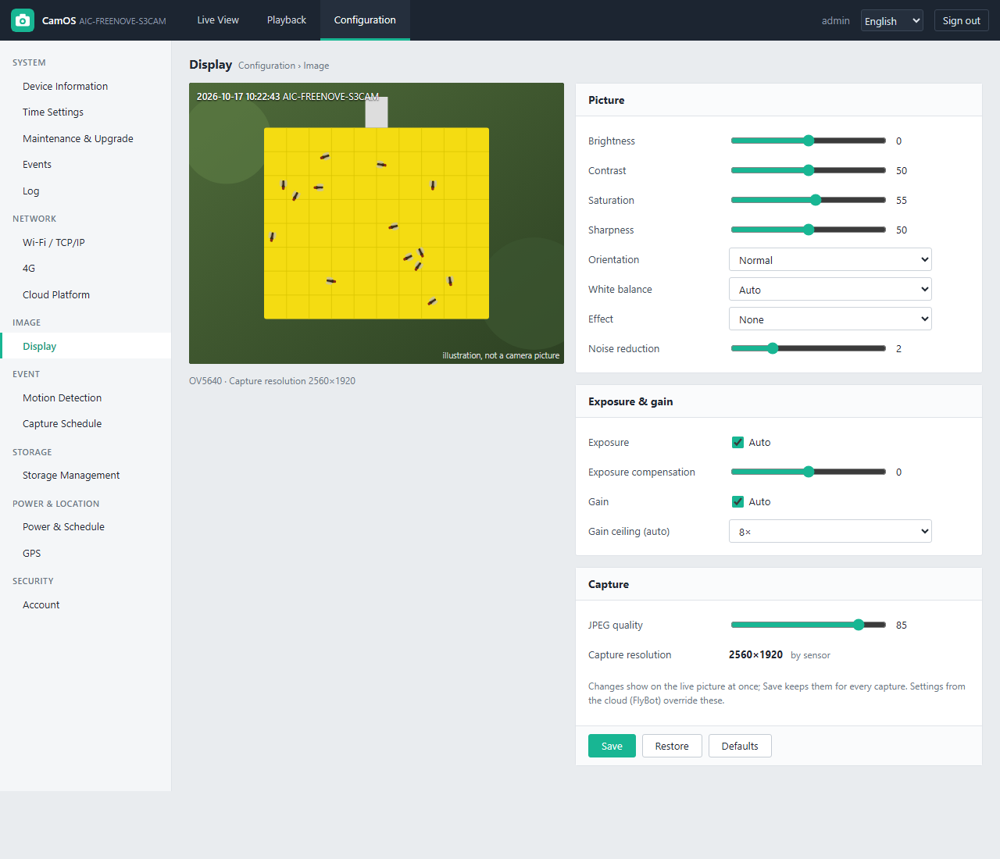 | 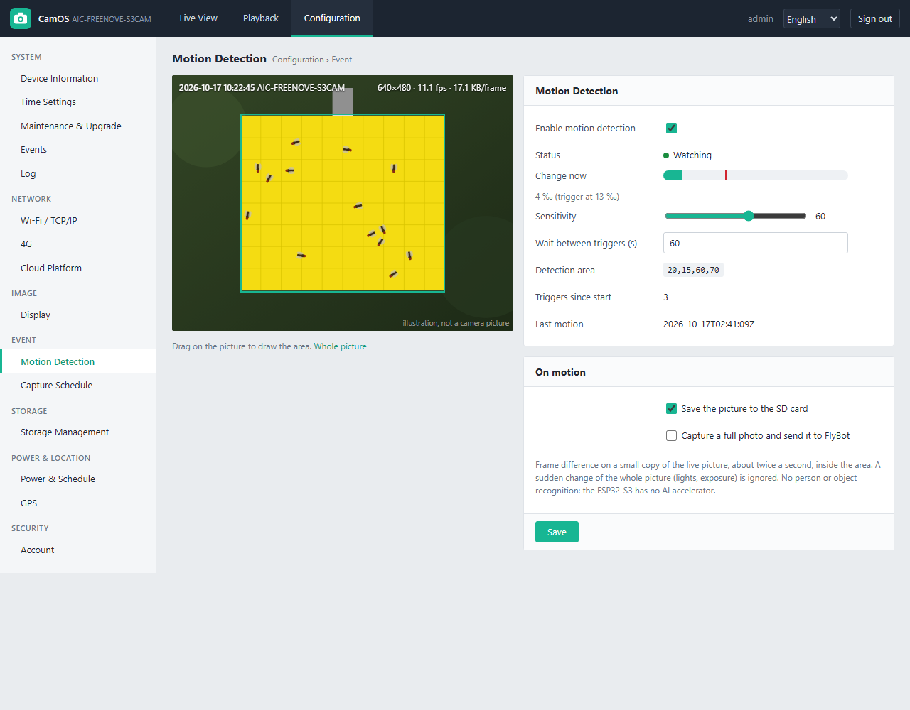 |
| **Capture Schedule** | **Storage Management** |
| 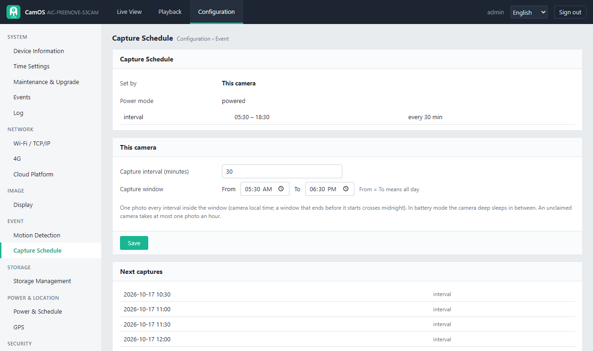 | 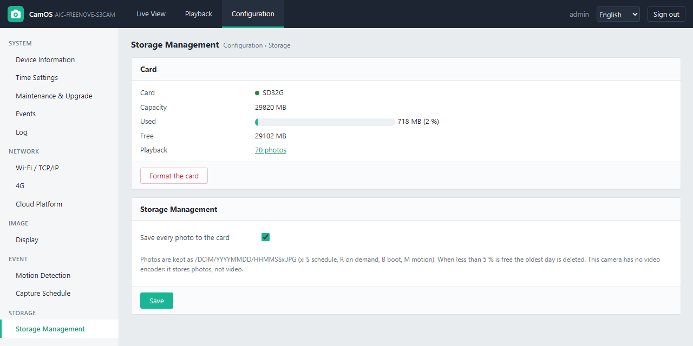 |
| **Wi-Fi / TCP/IP** | **Cloud Platform** (and while unclaimed) |
| 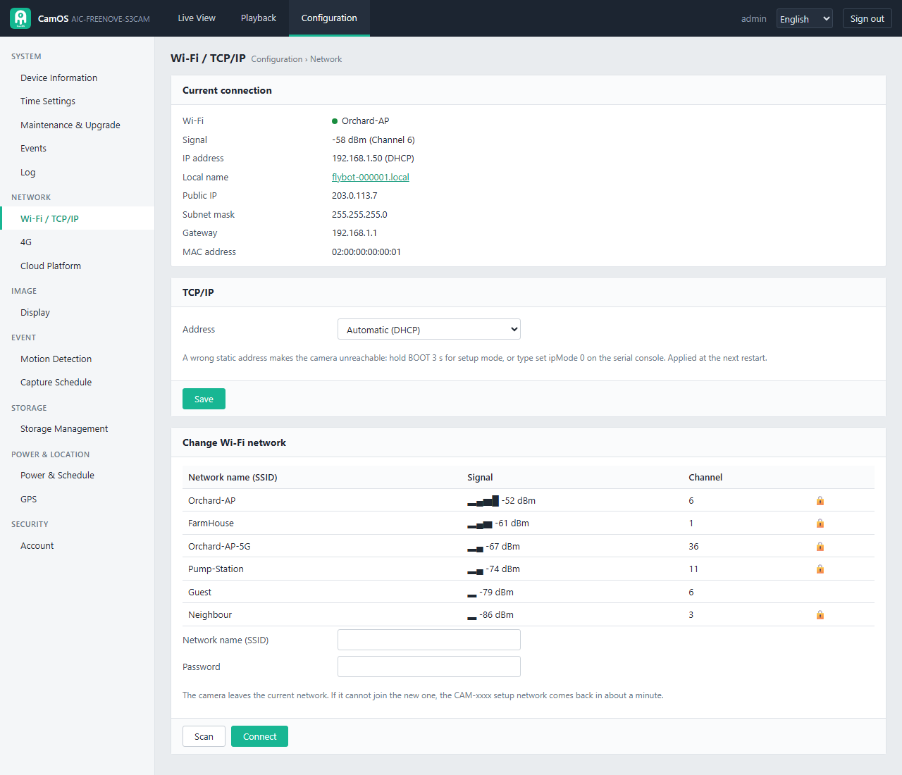 | 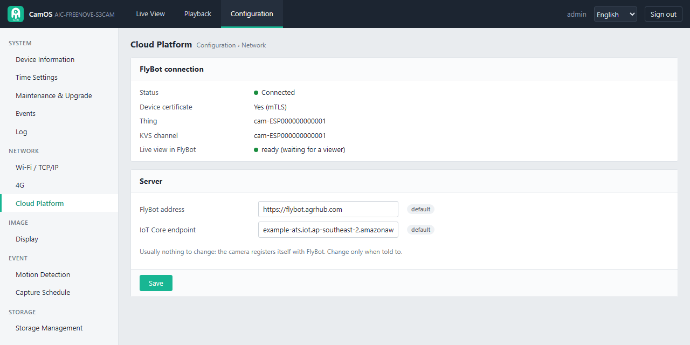 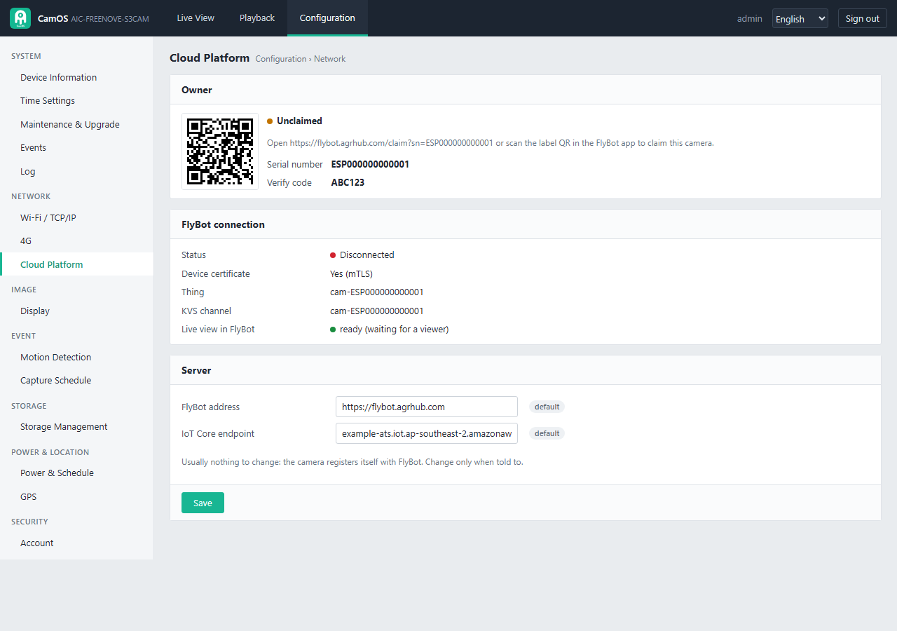 |
| **Device Information** | **Maintenance & Upgrade** |
| 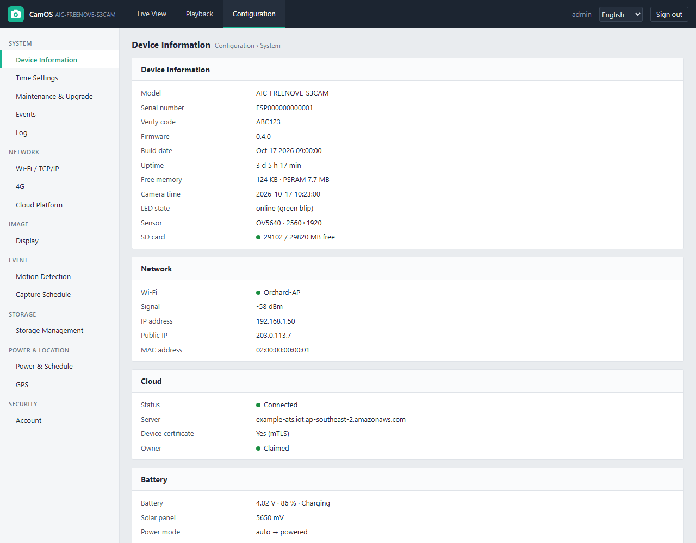 | 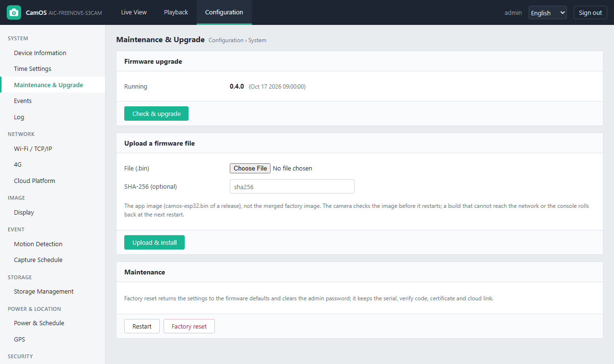 |
| **Events** | **Account** |
| 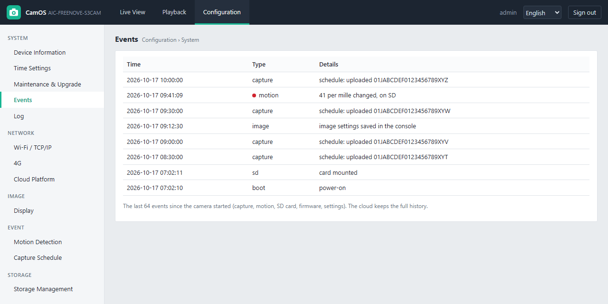 | 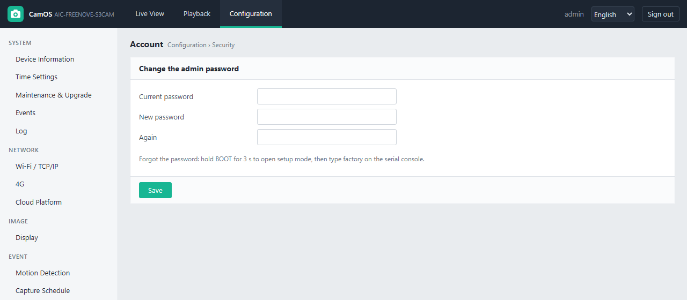 |
| **Xem trực tiếp (Vietnamese)** | **Phát hiện chuyển động** |
|  |  |

## Live picture on the LAN (MJPEG)

`GET /api/stream?w=640&h=480&q=12` answers `multipart/x-mixed-replace;boundary=camosframe`, one JPEG per part with its
`Content-Length`. Sizes: 320x240, 640x480 (default), 800x600, 1024x768, 1280x720, 1280x1024, 1600x1200; JPEG quality
8..40 (lower = better; the page offers 10 high, 12 standard, 20 smooth). The stream runs in a task of its own (async
HTTP request), so the console keeps answering while it plays, and Wi-Fi power save is off while it plays.

- **One viewer at a time.** A second viewer gets `409 {"error":"BUSY","message":"another viewer is watching: one live
  picture at a time"}`; the page then shows a still every 2 s (`GET /api/frame.jpg`) with that message and takes the
  stream over as soon as it is free.
- The page closes the stream while its tab is hidden and opens it again when the tab comes back.
- A scheduled or on-demand capture takes the camera for a few seconds (full-size JPEG); the stream carries on after.
- A stream ends after 30 minutes, when the viewer goes away, or when a FlyBot viewer connects over the cloud (KVS
  WebRTC, [dev/LIVE_VIEW.md](dev/LIVE_VIEW.md)): the camera then belongs to the H.264 encoder, and `/api/stream`
  answers `409 BUSY` ("live view over KVS is running") until that viewer leaves and while a `live.start` window is open.
  `/api/status` has the cloud live view's state under `live` (`joined`, `viewer`, frame rate).

Measured on the Freenove ESP32-S3 CAM (OV5640, XCLK 10 MHz), Wi-Fi at -47 dBm, laptop on the same access point, 16 Oct 2026
(firmware 0.4.0, `/api/stream` read for 10-12 s by a script, quality 12):

| Size | Frame rate | Frame size, dark room | Frame size, bright noisy picture (gain 30) |
|---|---|---|---|
| 320x240 | 11.1 fps | 2.1 KB | not measured |
| 640x480 | 11.1 fps (browser: 10.7-11.2 fps) | 6.6 KB | 17.5 KB (1.6 Mbit/s) |
| 800x600 | 11.0 fps | 11.3 KB | not measured |
| 1280x720 | 12.7 fps | 18.7 KB | 63.5 KB (6.4 Mbit/s) |
| 1600x1200 | 2.2 fps | 38.2 KB | not measured |

Up to HD the sensor sets the pace (the network carried 6.4 Mbit/s); UXGA drops to the OV5640's slow full-size mode.
With motion detection running at the same time VGA dropped to about 9 fps. A daylight scene was not available (the
measurement ran at night): frame sizes of a lit scene are still to be measured.

## Image settings

All under the shadow `video.image` ([dev/PROTOCOL_ADDITIONS.md](dev/PROTOCOL_ADDITIONS.md) section 3), so the console and FlyBot use the same keys:
brightness, contrast, saturation, sharpness, orientation (normal, mirror, flip, both), white balance (auto, sunny,
cloudy, office, home), effect (none, negative, black & white, red, green, blue tint, sepia), exposure (auto or manual
0..1200), exposure compensation (-5..5 on the OV5640), gain (auto or manual 0..30), gain ceiling (2x..128x), noise
reduction (0..8), plus `capture.jpegQuality`. `POST /api/image {"image":{...},"save":false}` previews on the running
camera only; `save` true (default) persists and publishes `reported`; `{"restore":true}` goes back to the saved values.
Leaving the page with unsaved changes restores the saved values. A later shadow from FlyBot overrides local values.

## microSD card

Freenove ESP32-S3 CAM: SD_MMC 1-bit (CLK 39, CMD 38, D0 40), FAT32, mounted at boot (`CAMOS_SD`, off on the AI-Thinker
ESP32-CAM whose card pins are the flash LED, the button and the battery ADC). With "save every photo" on (default)
every capture is written as `/DCIM/YYYYMMDD/HHMMSSx.JPG` (x: `S` schedule, `R` on demand, `B` boot, `M` motion), also
when the upload fails. Below 5 % free the oldest day is deleted. The card's API: [dev/CONFIG.md](dev/CONFIG.md).

## Motion detection

Runs while it is enabled **and** the effective power mode is powered (a battery camera deep sleeps; a board without a battery divider
is powered in `auto`). About twice a second it decodes the
preview picture at 1/4 or 1/8 scale (80..200 pixels across), turns it grey and compares it with a running average of
the scene inside the detection area: a pixel counts as changed above 12..51 grey levels, motion is 1..30 per mille of
the area changed (both from the sensitivity, 100 = most sensitive). A change of 70 % of the whole picture at once
(lights, exposure) is taken as a new scene, not motion. On motion, at most once per cooldown: the picture goes to the
SD card (`M`), the protocol event `motion` is published, and with "capture a full photo" a full-size photo is captured
and uploaded (FlyBot sees trigger `rpc`, the `capture` event says `motion`). The algorithm is host-tested
(`tests/test_motion.c`). No person or object recognition on the camera: the ESP32-S3 has no AI accelerator; the
counting stays in the cloud.

## Firmware upload

Configuration > Maintenance & Upgrade > Upload a firmware file: pick the `-update.bin` of a release (or
`camos-esp32.bin` of your own build), optionally paste its SHA-256 from the release page, Upload & install. The camera
writes it to its second firmware slot, checks it, then restarts into it. The new image marks itself
valid on its first MQTT connection or on the first signed-in console request; otherwise the bootloader rolls back at
the next restart. Measured on 16 Oct 2026: a 1.43 MB image uploaded and installed in 13 s over Wi-Fi.

## What this camera cannot do (hardware)

- **RTSP / ONVIF / RTMP video, continuous video recording, H.264 at large sizes**: the ESP32-S3 has no video encoder;
  the camera streams and stores JPEG pictures. The cloud live view in FlyBot uses a small software H.264 stream
  (320x240, 5-8 fps measured) over KVS WebRTC ([dev/LIVE_VIEW.md](dev/LIVE_VIEW.md)).
- **Audio**: no microphone or speaker on the board.
- **On-screen text burned into the photos and privacy masks**: would need a decode and re-encode of every 5 MP JPEG;
  the clock and name are drawn by the browser over the live picture only.
- **Person / vehicle detection on the camera**: no AI accelerator; motion detection is frame difference.
- **Several user accounts and roles**: one admin account.
