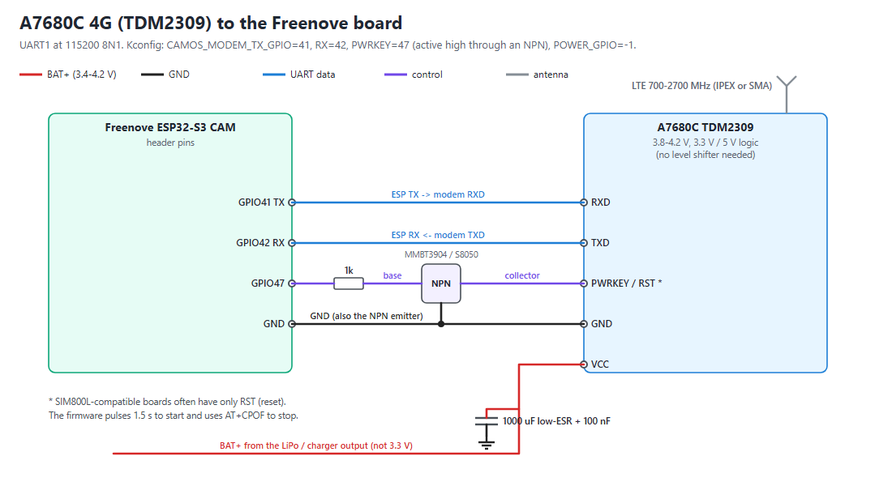
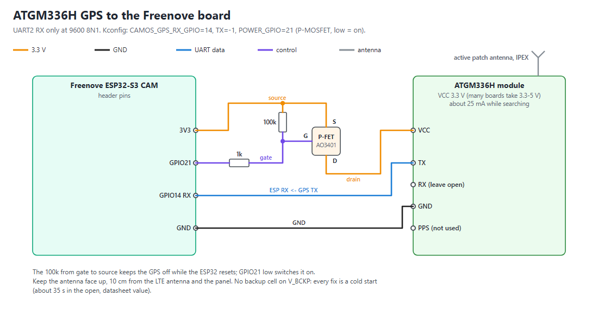
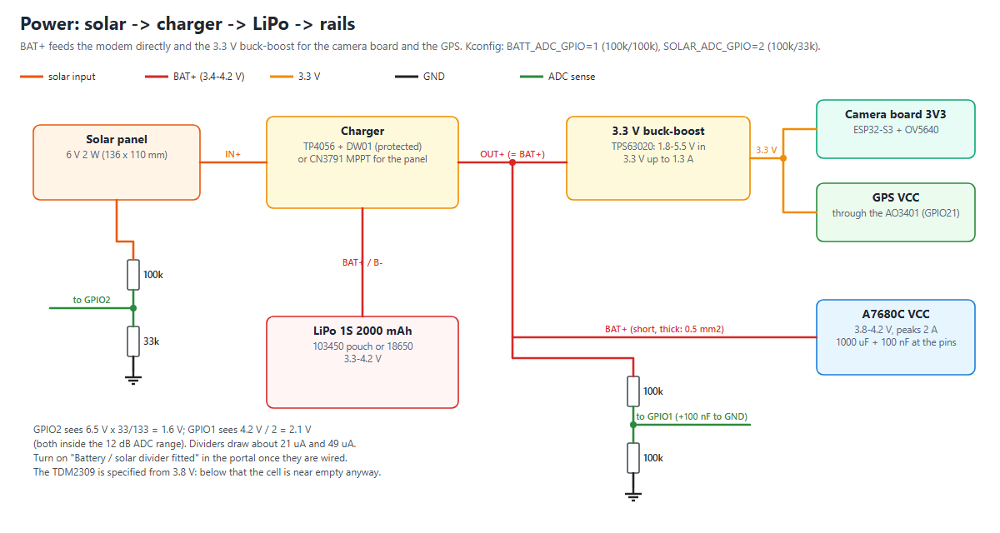

# Wiring

The Wi-Fi camera needs no wiring: the Freenove board, its camera and a USB cable. This page is for the **field camera**
(4G + GPS + solar). Pin numbers are the firmware defaults of the Freenove preset; a different pin needs a build from
source ([dev/BUILD.md](dev/BUILD.md), menu "CamOS trap camera").

Parts: [BOM.md](BOM.md). The 4G board, the GPS board and the charger below are wired from their datasheets and shop
descriptions; check the silkscreen of the boards you receive against the tables before the first power-up.

[SVG](img/wiring-overview.svg) · per module: [4G](img/wiring-4g.png) · [GPS](img/wiring-gps.png) · [power](img/wiring-power.png)

## 1. The Freenove ESP32-S3 CAM board (FNK0085)

On the board, nothing to wire: OV5640 camera on the ribbon connector, microSD slot (SD_MMC: CLK 39, CMD 38, D0 40), RGB
status LED (WS2812, GPIO48), BOOT button (GPIO0, the setup button: hold 3 s for setup, 10 s for a factory reset), USB-C with a CH340 serial chip (flashing
and the serial console).

Free header pins used by the firmware:

| Function | GPIO | Firmware setting | Wire to |
|---|---|---|---|
| Battery voltage (ADC1_CH0) | 1 | `CAMOS_BATT_ADC_GPIO` | middle of a 100k / 100k divider from BAT+ to GND, 100 nF to GND |
| Solar voltage (ADC1_CH1) | 2 | `CAMOS_SOLAR_ADC_GPIO` | middle of a 100k / 33k divider from the panel + to GND (GPIO2 also has the board's small LED: it may glow faintly) |
| GPS TX -> ESP RX (UART2) | 14 | `CAMOS_GPS_RX_GPIO` | ATGM336H TX |
| GPS power switch | 21 | `CAMOS_GPS_POWER_GPIO` | AO3401 gate through 1k (low = GPS on) |
| ESP TX -> modem RXD (UART1) | 41 | `CAMOS_MODEM_TX_GPIO` | A7680C RXD |
| ESP RX <- modem TXD (UART1) | 42 | `CAMOS_MODEM_RX_GPIO` | A7680C TXD |
| Modem PWRKEY | 47 | `CAMOS_MODEM_PWRKEY_GPIO` | NPN base through 1k (high = PWRKEY pulled low) |
| Modem rail switch (optional) | not used | `CAMOS_MODEM_POWER_GPIO` = -1 | GPIO45 or 3 if you add a second P-MOSFET for the modem supply |
| Charger CHRG (optional) | not used | `CAMOS_CHARGING_GPIO` = -1 | GPIO46 (input only) |
| 3.3 V supply | 3V3 pin | | the 3.3 V buck-boost output |
| Ground | GND pins | | every module's GND |

Wired differently? Five settings describe the wiring and are kept on the camera (NVS), so a firmware update built
with the defaults above does not undo them: `modemPwrkey` (-1 when PWRKEY is not wired), `modemFastBaud`,
`gpsPowerActiveLow` (`0` for an NPN such as a C1815 on the GPS ground, or GPIO21 powering the module), `battDivider` and
`solarDivider` (ratio x 100: `500` for the 30k/7.5k "voltage sensor" module). Set them on the serial console
(`set battDivider 500`) or with `POST /api/config`, then restart. See [CONFIG.md](dev/CONFIG.md).

**Feed the board at its 3V3 pin from the buck-boost, not at 5 V**: from a LiPo (3.3-4.2 V) the board's own 5 V
regulator path has no headroom. The ESP32-S3 with Wi-Fi peaks around 500 mA and the OV5640 adds about 150 mA at full size
(datasheet values): the regulator needs at least 1 A.

## 2. 4G: SIMCom A7680C on the TDM2309 board

| TDM2309 pin | Connect to | Notes |
|---|---|---|
| VCC | BAT+ (the cell / charger output) | 3.8-4.2 V, **not** 3.3 V. Peaks up to about 2 A: short wires of 0.5 mm2, a 1000 uF capacitor plus 100 nF right at VCC-GND |
| GND | common ground | |
| RXD | GPIO41 | UART 115200 8N1; the board takes 3.3 V and 5 V logic, no level shifter |
| TXD | GPIO42 | |
| PWRKEY (or RST) | collector of an NPN (MMBT3904 / S8050); emitter to GND; base to GPIO47 through 1k | the board keeps the SIM800L pinout; use its PWRKEY pin, or RST if that is all it has |
| antenna | LTE antenna (IPEX on the board, or a pigtail to an SMA antenna outside the box) | 700-2700 MHz |
| SIM | nano SIM with data | the APN is chosen from the SIM ([APN.md](APN.md)) |

The firmware first checks whether the modem already answers (many SIM800L-style boards power up by themselves), then
pulses PWRKEY 1.5 s to start it. Before a deep sleep it sends `AT+CPOF` and, if the modem still answers, holds PWRKEY
3 s. Without the NPN (a GPIO wired straight to PWRKEY through 1k), build with `CAMOS_MODEM_PWRKEY_ACTIVE_HIGH=n`.
With PWRKEY not wired at all (the TDM2309 starts by itself), `set modemPwrkey -1`: the module then stays on and
the radio is switched off with `AT+CFUN=0` before a deep sleep.

## 3. GPS: ATGM336H

| ATGM336H pin | Connect to | Notes |
|---|---|---|
| VCC | drain of the AO3401 P-MOSFET; its source to 3V3 | the firmware switches the GPS on only for a fix (once a day): GPIO21 low = on |
| GND | common ground | |
| TX | GPIO14 | NMEA at 9600 baud |
| RX | not connected | the firmware only listens |
| PPS | not connected | |
| antenna | active patch antenna, IPEX | face up, 10 cm or more from the LTE antenna and the panel |

AO3401: gate to GPIO21 through 1k, and 100k from the gate to the source (keeps the GPS off while the ESP32 starts).
The module has no backup cell: every fix is a cold start, about 35 s under open sky (datasheet value), longer under
trees.

## 4. Power: solar -> charger -> LiPo -> rails

| From | To | Notes |
|---|---|---|
| Solar panel + / - | charger IN+ / IN- | 6 V 2 W panel with a TP4056 board; a CN3791 board needs the panel voltage it is made for (the boards sold in Vietnam are 9 V versions) |
| Charger B+ / B- | LiPo + / - | protected cell, or the charger's DW01 protection |
| Charger OUT+ (= BAT+) | modem VCC, buck-boost IN, battery divider | thick, short wires to the modem |
| Buck-boost 3.3 V OUT | board 3V3, AO3401 source (GPS) | |
| Panel + | solar divider 100k / 33k -> GPIO2 | 6.5 V reads as 1.6 V on the pin |
| BAT+ | battery divider 100k / 100k -> GPIO1 | 4.2 V reads as 2.1 V; 100 nF from GPIO1 to GND |

The two dividers draw about 21 uA (battery) and 49 uA (panel, in the sun). After wiring them, switch on
"Battery / solar divider fitted" in the setup page or the web console (Power & Schedule): until then the camera ignores
the readings and treats `auto` power mode as powered (a USB / mains camera), so it never deep sleeps.

## 5. AI-Thinker ESP32-CAM

The cheaper Wi-Fi-only alternative: no 4G and no GPS in its firmware. Battery divider on GPIO14 (read before Wi-Fi
starts), a push button between GPIO13 and GND for the setup portal, the flash LED on GPIO4. It has no USB: flash it with a
USB-serial adapter (5 V, TX, RX, GND) and GPIO0 tied to GND while powering up ([../tools/README.md](../tools/README.md)).

## 6. Order of assembly

1. The board alone on USB: flash, set up Wi-Fi, take a snapshot from the web console.
2. Add the battery divider (GPIO1); compare the web console's battery value with a multimeter.
3. Add the GPS with its switch; take a fix outdoors (Power & location > GPS > Get position now).
4. Add the modem with its own thick supply wires; insert the SIM; the 4G page shows the operator and the signal.
5. Then the solar charger, the cell and the box ([ASSEMBLY.md](ASSEMBLY.md)).
