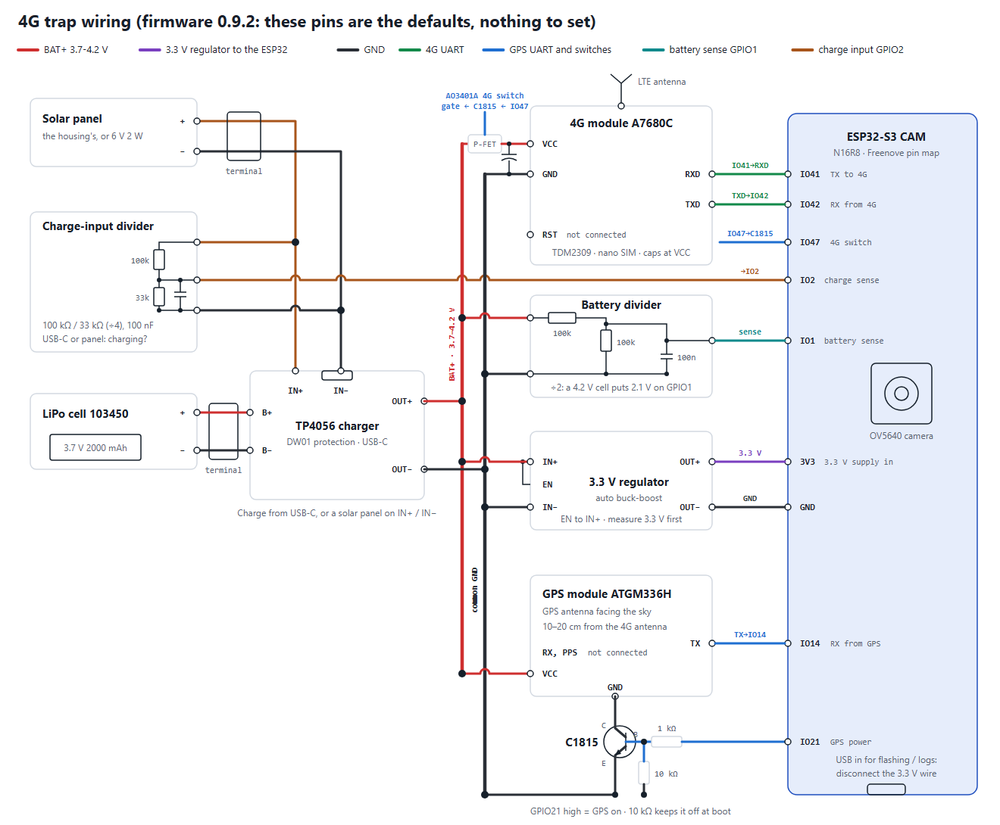

# Wiring

The Wi-Fi camera needs no wiring: the Freenove board, its camera and a USB cable. This page is for the **field camera**
(4G + GPS + solar). Pin numbers are the firmware defaults of the Freenove preset; a different pin needs a build from
source ([dev/BUILD.md](dev/BUILD.md), menu "CamOS trap camera").

Parts: [BOM.md](BOM.md). The 4G board, the GPS board and the charger below are wired from their datasheets and shop
descriptions; check the silkscreen of the boards you receive against the tables before the first power-up.

[SVG](img/wiring-overview.svg). Wired as drawn, firmware 0.9.2 and later needs no setting.

## 1. The Freenove ESP32-S3 CAM board (FNK0085)

On the board, nothing to wire: OV5640 camera on the ribbon connector, microSD slot (SD_MMC: CLK 39, CMD 38, D0 40), RGB
status LED (WS2812, GPIO48), BOOT button (GPIO0, the setup button: hold 3 s for setup, 10 s for a factory reset), USB-C with a CH340 serial chip (flashing
and the serial console).

Free header pins used by the firmware:

| Function | GPIO | Firmware setting | Wire to |
|---|---|---|---|
| Battery voltage (ADC1_CH0) | 1 | `CAMOS_BATT_ADC_GPIO` | middle of a 100k / 100k divider from BAT+ to GND, 100 nF to GND |
| Solar voltage (ADC1_CH1) | 2 | `CAMOS_SOLAR_ADC_GPIO` | middle of a 100k / 33k divider from the panel + to GND (GPIO2 also has the board's small LED: it may glow faintly) |
| GPS TX -> ESP RX (UART2) | 14 | `CAMOS_GPS_RX_GPIO` | ATGM336H TX |
| GPS power switch | 21 | `CAMOS_GPS_POWER_GPIO` | base of the C1815 on the GPS ground, through 1k (high = GPS on) |
| ESP TX -> modem RXD (UART1) | 41 | `CAMOS_MODEM_TX_GPIO` | A7680C RXD |
| ESP RX <- modem TXD (UART1) | 42 | `CAMOS_MODEM_RX_GPIO` | A7680C TXD |
| 4G power switch | 47 | `CAMOS_MODEM_POWER_GPIO` | base of the C1815 that drives the AO3401 gate, through 1k (high = 4G on); see section 2 |
| Charger CHRG (optional) | not used | `CAMOS_CHARGING_GPIO` = -1 | GPIO46 (input only) |
| 3.3 V supply | 3V3 pin | | the 3.3 V regulator output (BOM item 15) |
| Ground | GND pins | | every module's GND |

Wired as on this page, the camera needs no setting (firmware 0.9.2 and later): these are the defaults. A board without
the 4G switch is found out by itself (section 2). Wired differently? Seven settings describe the wiring and are kept
on the camera (NVS), so a firmware update does not undo them: `modemPower` (GPIO of the 4G switch, -1 none),
`modemPowerActiveLow` (`1` for a P-MOSFET gate driven straight), `modemPwrkey` (GPIO of PWRKEY, -1 not wired, the
default), `modemFastBaud`, `gpsPowerActiveLow` (`1` for a P-MOSFET on the GPS supply), `battDivider` and
`solarDivider` (ratio x 100: `500` for the 30k/7.5k "voltage sensor" module). Set them on the serial console
(`set battDivider 500`) or with `POST /api/config`, then restart. See [CONFIG.md](dev/CONFIG.md).

**Feed the board at its 3V3 pin from a 3.3 V auto buck-boost regulator, not at 5 V**: from a LiPo (3.3-4.2 V) the
board's own 5 V regulator path has no headroom, and a 5 V boost board only adds a second conversion. The regulator of
BOM item 15 (2-15 V in, 3.3 V 0.6 A out) covers the board on 4G. The ESP32-S3 with Wi-Fi peaks around 500 mA and the
OV5640 adds about 150 mA at full size (datasheet values): a camera that also runs Wi-Fi from the cell is safer with the
1.3 A TPS63020 (item 15b). **If the regulator board has an EN pin, tie EN to its VCC (input)**: left open, the module
stays off.

The regulator, the two dividers, the capacitors and two screw terminals (KF301-2P: the LiPo and the solar panel) go on
a double-sided 7 x 9 cm prototype board (BOM items 24, 25), so the cell and the panel can be changed without
soldering.

## 2. 4G: SIMCom A7680C on the TDM2309 board

| TDM2309 pin | Connect to | Notes |
|---|---|---|
| VCC | BAT+ (the cell / charger output) | 3.8-4.2 V, **not** 3.3 V. Peaks up to about 2 A: short wires of 0.5 mm2, a 1000 uF low-ESR capacitor (two are better) plus 100 nF right at VCC-GND. Without them a cell near 3.8 V let the transmit peaks break the UART link ("Rx Break", CMUX restarts) and every connection failed (24 Oct 2026) |
| GND | common ground | |
| RXD | GPIO41 | UART 115200 8N1; the board takes 3.3 V and 5 V logic, no level shifter |
| TXD | GPIO42 | |
| PWRKEY (or RST) | not connected | the TDM2309 starts by itself when it gets power (see below for a breakout that needs PWRKEY) |
| antenna | LTE antenna (IPEX on the board, or a pigtail to an SMA antenna outside the box) | 700-2700 MHz |
| SIM | nano SIM with data | the APN is chosen from the SIM ([APN.md](APN.md)) |

**Power switch.** Wired straight to the cell, the module would stay on when the ESP32 cannot run (a cell too
low for it, a brownout) and drain the cell. A P-MOSFET between the cell and the module's VCC cuts it then:

| Part | Pin | Connect to |
|---|---|---|
| AO3401A (BOM item 16) | S (source) | BAT+ (the charger's OUT+) |
| AO3401A | D (drain) | 4G VCC; the 1000 uF and 100 nF capacitors go on this side, at the module |
| AO3401A | G (gate) | 100k to the source (keeps the module off by default), and the NPN collector |
| NPN (C1815, S8050, MMBT3904) | E | GND |
| NPN | B | GPIO47 through 1k, and 10k to GND |

GPIO47 high = 4G on. Not an NPN alone in the supply: it carries 150-200 mA, the module peaks at 2 A. The firmware
switches the module on before it starts it, and off through deep sleep and while the camera is on Wi-Fi. Without the
switch (the module wired straight to the cell) the module still answers the first time GPIO47 goes low: the firmware
then switches its radio off with `AT+CFUN=0` instead, as before.

The TDM2309 board starts by itself when it gets power, so PWRKEY is not wired. A breakout that needs PWRKEY: an NPN
on its PWRKEY pin from a free GPIO (`set modemPwrkey <gpio>`); the firmware then pulses it 1.5 s to start the module
and sends `AT+CPOF` before a deep sleep.

## 3. GPS: ATGM336H

| ATGM336H pin | Connect to | Notes |
|---|---|---|
| VCC | BAT+, with the 4G module | ATGM336H boards with their own regulator take 3.3-5 V (check yours); on the cell, the GPS does not draw on the 3.3 V regulator while the 4G module transmits |
| GND | collector of an NPN C1815; emitter to GND | the firmware switches the GPS on only for a fix: GPIO21 high = on |
| TX | GPIO14 | NMEA at 9600 baud |
| RX | not connected | the firmware only listens |
| PPS | not connected | |
| antenna | active patch antenna, IPEX | face up, 10 cm or more from the LTE antenna and the panel |

C1815: base to GPIO21 through 1k, and 10k from the base to GND (keeps the GPS off while the ESP32 starts). A P-MOSFET on
the GPS supply instead (AO3401 from 3V3, gate low = on) needs `set gpsPowerActiveLow 1`.
The module has no backup cell: every fix is a cold start, about 35 s under open sky (datasheet value), longer under
trees.

## 4. Power: solar -> charger -> LiPo -> rails

| From | To | Notes |
|---|---|---|
| Solar panel + / - | screw terminal -> charger IN+ / IN- | 6 V 2 W panel with a TP4056 board; a CN3791 board needs the panel voltage it is made for (the boards sold in Vietnam are 9 V versions). A small panel that cannot give the charger its full current sags to just above the cell: the camera then reports `charge: "slow"` |
| Charger B+ / B- | screw terminal -> LiPo + / - | a flat LiPo (BOM item 12) or an old phone battery; protected cell, or the charger's DW01 protection |
| Charger OUT+ (= BAT+) | the 4G switch (AO3401 source) -> modem VCC, GPS VCC, regulator VIN, battery divider | thick, short wires to the modem |
| Regulator EN | regulator VIN | only on boards that have an EN pin: without it the regulator stays off |
| Regulator 3.3 V OUT | board 3V3 | |
| Panel + | solar divider 100k / 33k -> GPIO2 | 6.5 V reads as 1.6 V on the pin |
| BAT+ | battery divider 100k / 100k -> GPIO1 | 4.2 V reads as 2.1 V; 100 nF from GPIO1 to GND |

The two dividers draw about 21 uA (battery) and 49 uA (panel, in the sun). After wiring them, switch on
"Battery / solar divider fitted" in the setup page or the web console (Power & Schedule): until then the camera ignores
the readings and treats `auto` power mode as powered (a USB / mains camera), so it never deep sleeps.

## 5. AI-Thinker ESP32-CAM

The cheaper Wi-Fi-only alternative: no 4G and no GPS in its firmware. Battery divider on GPIO14 (read before Wi-Fi
starts), a push button between GPIO13 and GND for the setup portal, the flash LED on GPIO4. It has no USB: flash it with a
USB-serial adapter (5 V, TX, RX, GND) and GPIO0 tied to GND while powering up ([../tools/README.md](../tools/README.md)).

## 6. Order of assembly

1. The board alone on USB: flash, set up Wi-Fi, take a snapshot from the web console.
2. Add the battery divider (GPIO1); compare the web console's battery value with a multimeter.
3. Add the GPS with its switch; take a fix outdoors (Power & location > GPS > Get position now).
4. Add the modem with its own thick supply wires; insert the SIM; the 4G page shows the operator and the signal.
5. Then the solar charger, the cell and the box ([ASSEMBLY.md](ASSEMBLY.md)).
